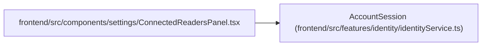

# AccountSession

**Location:** `frontend/src/features/identity/identityService.ts:24`
**Kind:** Interface
**Bases:** —
**Module:** [identityService](../modules/identityService.md)

## Description

One session of this account, or on a trusted-local server, one paired reader.

## Attributes

| Name | Type | Required | Default | Description |
|------|------|----------|---------|-------------|
| `public_id` | `string` | Yes | — | — |
| `created_at` | `string` | Yes | — | — |
| `expires_at` | `string \| null` | Yes | — | — |
| `revoked_at` | `string \| null` | Yes | — | — |
| `user_agent` | `string \| null` | Yes | — | — |
| `current` | `boolean` | Yes | — | — |
| `access` | `'full' \| 'observe'` | Yes | — | — |
| `client_label` | `string \| null` | Yes | — | — |

## Methods

*No declared methods.*

## Relationships

<!-- Auto-generated relationship summary. Do not edit by hand. -->

### Summary

| Module | Methods | Attributes |
|---|---:|---|
| [identityService](../modules/identityService.md) | 0 | `access`, `client_label`, `created_at`, `current`, `expires_at`, `public_id`, `revoked_at`, `user_agent` |

### References

| Reference | Kind | Source | Call sites |
|---|---|---|---:|
| `ConnectedReadersPanel` | import | [ConnectedReadersPanel](../modules/ConnectedReadersPanel.md) | — |
