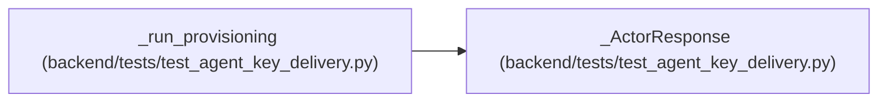

# _ActorResponse

**Location:** `backend/tests/test_agent_key_delivery.py:112`
**Kind:** Class
**Bases:** —
**Module:** [test_agent_key_delivery](../modules/test_agent_key_delivery.md)

## Description

_Auto-generated from `_ActorResponse` in `backend/tests/test_agent_key_delivery.py`._

## Attributes

*No annotated attributes found.*

## Methods

| Method | Signature | Decorators | Description |
|--------|-----------|------------|-------------|
| `__enter__` | `()` | — | — |
| `__exit__` | `(*_args: Any) -> None` | — | — |
| `read` | `() -> bytes` | — | — |

## Relationships

<!-- Auto-generated relationship summary. Do not edit by hand. -->

### Summary

| Module | Methods | Attributes |
|---|---:|---|
| [test_agent_key_delivery](../modules/test_agent_key_delivery.md) | 3 | — |

### References

| Reference | Kind | Source | Call sites |
|---|---|---|---:|
| `_run_provisioning` | call | [test_agent_key_delivery](../modules/test_agent_key_delivery.md) | 1 |
