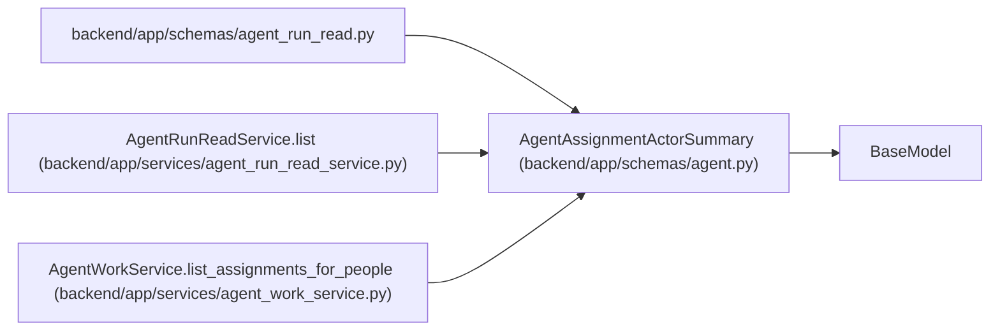

# AgentAssignmentActorSummary

**Location:** `backend/app/schemas/agent.py:714`
**Kind:** Pydantic model
**Bases:** `BaseModel`
**Module:** [schemas_agent](../modules/schemas_agent.md)

## Description

The actor an assignment names, so a person can tell who holds the work.

## Attributes

| Name | Type | Wire name | Required | Nullable | Default | Constraints | Examples | Description |
|------|------|-----------|----------|----------|---------|-------------|-------------|----------|
| `id` | `int` | `id` | Yes | No | — | — | — | — |
| `name` | `str` | `name` | Yes | No | — | — | — | — |
| `display_name` | `Optional[str]` | `display_name` | No | Yes | `None` | — | — | — |
| `role` | `str` | `role` | Yes | No | — | — | — | — |

## Methods

*No declared methods.*

## Relationships

<!-- Auto-generated relationship summary. Do not edit by hand. -->

### Summary

| Module | Methods | Attributes |
|---|---:|---|
| [schemas_agent](../modules/schemas_agent.md) | 0 | `display_name`, `id`, `name`, `role` |

### Structure

| Kind | Entity | Module |
|---|---|---|
| Base | `BaseModel` | — |

### References

| Reference | Kind | Source | Call sites |
|---|---|---|---:|
| `agent_run_read` | import | [agent_run_read](../modules/agent_run_read.md) | — |
| `AgentRunReadService.list` | call | [agent_run_read_service](../modules/agent_run_read_service.md) | 1 |
| `AgentWorkService.list_assignments_for_people` | call | [agent_work_service](../modules/agent_work_service.md) | 1 |
