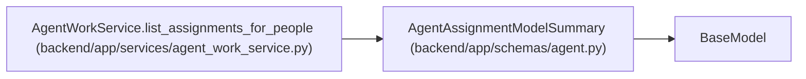

# AgentAssignmentModelSummary

**Location:** `backend/app/schemas/agent.py:682`
**Kind:** Pydantic model
**Bases:** `BaseModel`
**Module:** [schemas_agent](../modules/schemas_agent.md)

## Description

The model an assignment's binding declares; a declaration, not an attestation.

## Attributes

| Name | Type | Wire name | Required | Nullable | Default | Constraints | Examples | Description |
|------|------|-----------|----------|----------|---------|-------------|-------------|----------|
| `model_catalog_key` | `str` | `model_catalog_key` | Yes | No | — | — | — | — |
| `provider` | `str` | `provider` | Yes | No | — | — | — | — |
| `configured_model_alias` | `str` | `configured_model_alias` | Yes | No | — | — | — | — |

## Methods

*No declared methods.*

## Relationships

<!-- Auto-generated relationship summary. Do not edit by hand. -->

### Summary

| Module | Methods | Attributes |
|---|---:|---|
| [schemas_agent](../modules/schemas_agent.md) | 0 | `configured_model_alias`, `model_catalog_key`, `provider` |

### Structure

| Kind | Entity | Module |
|---|---|---|
| Base | `BaseModel` | — |

### References

| Reference | Kind | Source | Call sites |
|---|---|---|---:|
| `AgentWorkService.list_assignments_for_people` | call | [agent_work_service](../modules/agent_work_service.md) | 1 |
