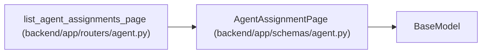

# AgentAssignmentPage

**Location:** `backend/app/schemas/agent.py:795`
**Kind:** Pydantic model
**Bases:** `BaseModel`
**Module:** [schemas_agent](../modules/schemas_agent.md)

## Description

One page of assignments; pass next_cursor back as cursor to read on.

## Attributes

| Name | Type | Wire name | Required | Nullable | Default | Constraints | Examples | Description |
|------|------|-----------|----------|----------|---------|-------------|-------------|----------|
| `items` | `list[AgentTaskAssignmentResponse] \| list[AgentAssignmentReadItem]` | `items` | Yes | No | — | — | — | — |
| `has_more` | `bool` | `has_more` | Yes | No | — | — | — | — |
| `next_cursor` | `str \| None` | `next_cursor` | No | Yes | `None` | — | — | — |

## Methods

*No declared methods.*

## Relationships

<!-- Auto-generated relationship summary. Do not edit by hand. -->

### Summary

| Module | Methods | Attributes |
|---|---:|---|
| [schemas_agent](../modules/schemas_agent.md) | 0 | `has_more`, `items`, `next_cursor` |

### Structure

| Kind | Entity | Module |
|---|---|---|
| Base | `BaseModel` | — |

### References

| Reference | Kind | Source | Call sites |
|---|---|---|---:|
| `list_agent_assignments_page` | type_reference | [routers_agent](../modules/routers_agent.md) | — |
