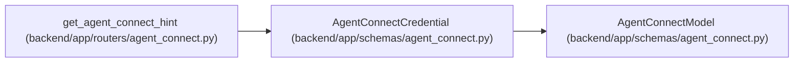

# AgentConnectCredential

**Location:** `backend/app/schemas/agent_connect.py:15`
**Kind:** Pydantic model
**Bases:** `AgentConnectModel`
**Module:** [schemas_agent_connect](../modules/schemas_agent_connect.md)

## Description

Where an agent sends its key and where its runtime may read it from.

## Attributes

| Name | Type | Wire name | Required | Nullable | Default | Constraints | Examples | Description |
|------|------|-----------|----------|----------|---------|-------------|-------------|----------|
| `rest_header` | `Literal['X-Agent-API-Key']` | `rest_header` | No | No | `'X-Agent-API-Key'` | — | — | — |
| `mcp_http_authorization_scheme` | `Literal['Bearer']` | `mcp_http_authorization_scheme` | No | No | `'Bearer'` | — | — | — |
| `key_sources` | `list[str]` | `key_sources` | Yes | No | — | — | — | — |
| `mcp_stdio_key_sources` | `list[str]` | `mcp_stdio_key_sources` | Yes | No | — | — | — | — |
| `default_key_file` | `str` | `default_key_file` | Yes | No | — | — | — | — |
| `anonymous_agent_access` | `Literal[False]` | `anonymous_agent_access` | No | No | `False` | — | — | — |

## Methods

*No declared methods.*

## Relationships

<!-- Auto-generated relationship summary. Do not edit by hand. -->

### Summary

| Module | Methods | Attributes |
|---|---:|---|
| [schemas_agent_connect](../modules/schemas_agent_connect.md) | 0 | `anonymous_agent_access`, `default_key_file`, `key_sources`, `mcp_http_authorization_scheme`, `mcp_stdio_key_sources`, `rest_header` |

### Structure

| Kind | Entity | Module |
|---|---|---|
| Base | `AgentConnectModel` | [schemas_agent_connect](../modules/schemas_agent_connect.md) |

### References

| Reference | Kind | Source | Call sites |
|---|---|---|---:|
| `get_agent_connect_hint` | call | [routers_agent_connect](../modules/routers_agent_connect.md) | 1 |
