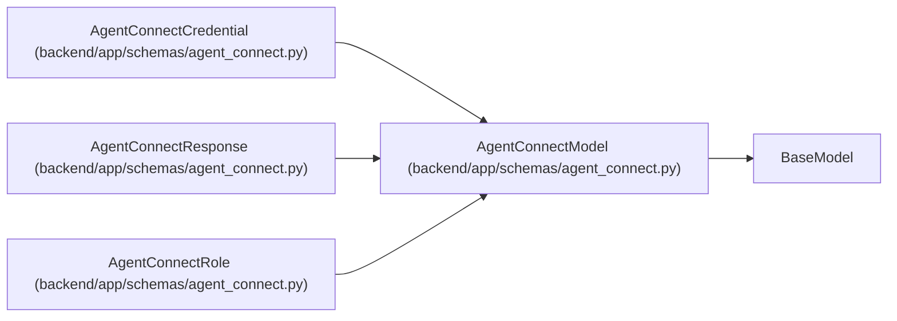

# AgentConnectModel

**Location:** `backend/app/schemas/agent_connect.py:9`
**Kind:** Pydantic model
**Bases:** `BaseModel`
**Module:** [schemas_agent_connect](../modules/schemas_agent_connect.md)

## Description

Reject undeclared fields so nothing extra is ever published here.

## Model Configuration

| Setting | Value | Source |
|---------|-------|--------|
| `extra` | `'forbid'` | model_config |

## Attributes

*No annotated attributes found.*

## Methods

*No declared methods.*

## Relationships

<!-- Auto-generated relationship summary. Do not edit by hand. -->

### Summary

| Module | Methods | Attributes |
|---|---:|---|
| [schemas_agent_connect](../modules/schemas_agent_connect.md) | 0 | — |

### Structure

| Kind | Entity | Module |
|---|---|---|
| Base | `BaseModel` | — |
| Subclass | `AgentConnectCredential` | [schemas_agent_connect](../modules/schemas_agent_connect.md) |
| Subclass | `AgentConnectResponse` | [schemas_agent_connect](../modules/schemas_agent_connect.md) |
| Subclass | `AgentConnectRole` | [schemas_agent_connect](../modules/schemas_agent_connect.md) |
