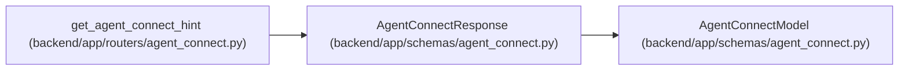

# AgentConnectResponse

**Location:** `backend/app/schemas/agent_connect.py:36`
**Kind:** Pydantic model
**Bases:** `AgentConnectModel`
**Module:** [schemas_agent_connect](../modules/schemas_agent_connect.md)

## Description

How to reach this server as an agent; never holds credentials or instance data.

## Attributes

| Name | Type | Wire name | Required | Nullable | Default | Constraints | Examples | Description |
|------|------|-----------|----------|----------|---------|-------------|-------------|----------|
| `schema_version` | `Literal['workchord-agent-connect/v1']` | `schema_version` | No | No | `'workchord-agent-connect/v1'` | — | — | — |
| `auth_mode` | `Literal['managed', 'trusted_local']` | `auth_mode` | Yes | No | — | — | — | — |
| `api_prefix` | `str` | `api_prefix` | Yes | No | — | — | — | — |
| `capabilities_path` | `str` | `capabilities_path` | Yes | No | — | — | — | — |
| `mcp_http_path` | `str` | `mcp_http_path` | Yes | No | — | — | — | — |
| `skill_discovery_path` | `str` | `skill_discovery_path` | Yes | No | — | — | — | — |
| `credential` | `AgentConnectCredential` | `credential` | Yes | No | — | — | — | — |
| `roles` | `list[AgentConnectRole]` | `roles` | Yes | No | — | — | — | — |
| `provisioning` | `list[str]` | `provisioning` | Yes | No | — | — | — | — |

## Methods

*No declared methods.*

## Relationships

<!-- Auto-generated relationship summary. Do not edit by hand. -->

### Summary

| Module | Methods | Attributes |
|---|---:|---|
| [schemas_agent_connect](../modules/schemas_agent_connect.md) | 0 | `api_prefix`, `auth_mode`, `capabilities_path`, `credential`, `mcp_http_path`, `provisioning`, `roles`, `schema_version`, `skill_discovery_path` |

### Structure

| Kind | Entity | Module |
|---|---|---|
| Base | `AgentConnectModel` | [schemas_agent_connect](../modules/schemas_agent_connect.md) |

### References

| Reference | Kind | Source | Call sites |
|---|---|---|---:|
| `get_agent_connect_hint` | call | [routers_agent_connect](../modules/routers_agent_connect.md) | 1 |
| `get_agent_connect_hint` | type_reference | [routers_agent_connect](../modules/routers_agent_connect.md) | — |
