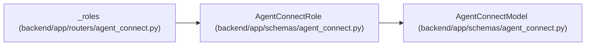

# AgentConnectRole

**Location:** `backend/app/schemas/agent_connect.py:26`
**Kind:** Pydantic model
**Bases:** `AgentConnectModel`
**Module:** [schemas_agent_connect](../modules/schemas_agent_connect.md)

## Description

The actor role and scopes an operator provisions for one role skill.

## Attributes

| Name | Type | Wire name | Required | Nullable | Default | Constraints | Examples | Description |
|------|------|-----------|----------|----------|---------|-------------|-------------|----------|
| `skill` | `str` | `skill` | Yes | No | — | — | — | — |
| `skill_version` | `str` | `skill_version` | Yes | No | — | — | — | — |
| `actor_role` | `Literal['pm', 'worker', 'verifier']` | `actor_role` | Yes | No | — | — | — | — |
| `required_scopes` | `list[str]` | `required_scopes` | Yes | No | — | — | — | — |
| `optional_scopes` | `list[str]` | `optional_scopes` | Yes | No | — | — | — | — |

## Methods

*No declared methods.*

## Relationships

<!-- Auto-generated relationship summary. Do not edit by hand. -->

### Summary

| Module | Methods | Attributes |
|---|---:|---|
| [schemas_agent_connect](../modules/schemas_agent_connect.md) | 0 | `actor_role`, `optional_scopes`, `required_scopes`, `skill`, `skill_version` |

### Structure

| Kind | Entity | Module |
|---|---|---|
| Base | `AgentConnectModel` | [schemas_agent_connect](../modules/schemas_agent_connect.md) |

### References

| Reference | Kind | Source | Call sites |
|---|---|---|---:|
| `_roles` | call | [routers_agent_connect](../modules/routers_agent_connect.md) | 1 |
| `_roles` | type_reference | [routers_agent_connect](../modules/routers_agent_connect.md) | — |
