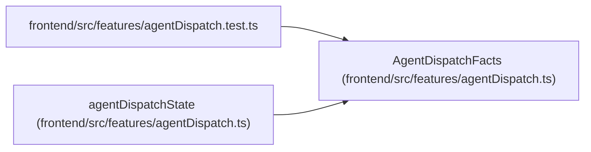

# AgentDispatchFacts

**Location:** `frontend/src/features/agentDispatch.ts:9`
**Kind:** Interface
**Bases:** —
**Module:** [agentDispatch](../modules/agentDispatch.md)

## Description

_Auto-generated from `AgentDispatchFacts` in `frontend/src/features/agentDispatch.ts`._

## Attributes

| Name | Type | Required | Default | Description |
|------|------|----------|---------|-------------|
| `status` | `TaskStatus` | Yes | — | — |
| `liveAssignment` | `boolean \| null` | No | — | — |
| `runBegun` | `boolean` | Yes | — | — |
| `agentConnected` | `boolean` | No | — | — |

## Methods

*No declared methods.*

## Relationships

<!-- Auto-generated relationship summary. Do not edit by hand. -->

### Summary

| Module | Methods | Attributes |
|---|---:|---|
| [agentDispatch](../modules/agentDispatch.md) | 0 | `agentConnected`, `liveAssignment`, `runBegun`, `status` |

### References

| Reference | Kind | Source | Call sites |
|---|---|---|---:|
| `agentDispatch.test` | import | [agentDispatch.test](../modules/agentDispatch.test.md) | — |
| `agentDispatchState` | type_reference | [agentDispatch](../modules/agentDispatch.md) | — |
