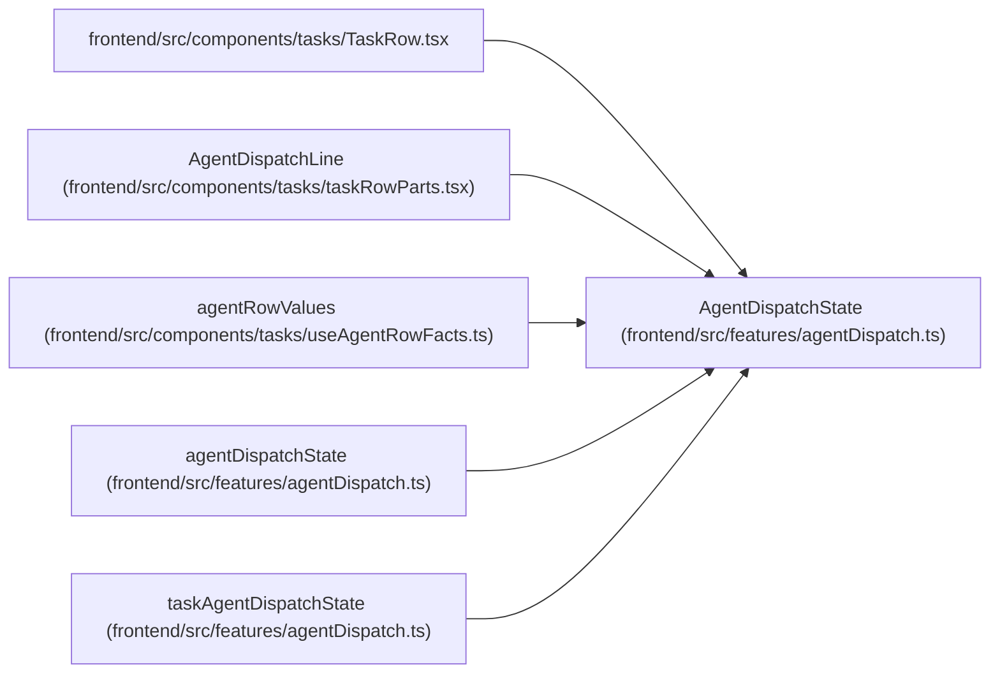

# AgentDispatchState

**Location:** `frontend/src/features/agentDispatch.ts:7`
**Kind:** Type alias
**Bases:** —
**Module:** [agentDispatch](../modules/agentDispatch.md)
**Target:**

```typescript
'noAgentConnected' | 'notSentYet' | 'queued' | 'working' | 'waitingForReview' | 'unknown'
```

## Description

Where an agent's work on a task stands, as one line under the agent's name. `unknown` is the
neutral line while the reads that say whether the agent is connected are loading or failed.

## Attributes

*See the alias definition for its member types.*

## Methods

*See the alias definition for callable and member types.*

## Relationships

<!-- Auto-generated relationship summary. Do not edit by hand. -->


### Summary

| Module | Methods | Attributes |
|---|---:|---|
| [agentDispatch](../modules/agentDispatch.md) | 0 | — |

### References

| Reference | Kind | Source | Call sites |
|---|---|---|---:|
| `TaskRow` | import | [TaskRow](../modules/TaskRow.md) | — |
| `AgentDispatchLine` | type_reference | [taskRowParts](../modules/taskRowParts.md) | — |
| `agentRowValues` | type_reference | [useAgentRowFacts](../modules/useAgentRowFacts.md) | — |
| `agentDispatchState` | type_reference | [agentDispatch](../modules/agentDispatch.md) | — |
| `taskAgentDispatchState` | type_reference | [agentDispatch](../modules/agentDispatch.md) | — |
