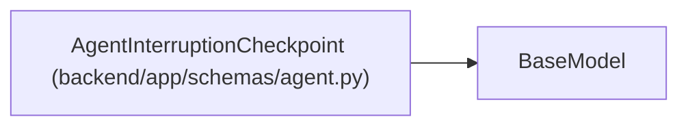

# AgentInterruptionCheckpoint

**Location:** `backend/app/schemas/agent.py:1089`
**Kind:** Pydantic model
**Bases:** `BaseModel`
**Module:** [schemas_agent](../modules/schemas_agent.md)

## Description

The worker has stopped producing output under this fence.

## Model Configuration

| Setting | Value | Source |
|---------|-------|--------|
| `extra` | `'forbid'` | model_config |

## Validators

| Method | Scope | Fields | Mode | Options |
|--------|-------|--------|------|---------|
| `validate_commits` | field | commit_urls | after | — |
| `validate_output` | model | — | after | — |

## Attributes

| Name | Type | Wire name | Required | Nullable | Default | Constraints | Examples | Description |
|------|------|-----------|----------|----------|---------|-------------|-------------|----------|
| `observed_model` | `str` | `observed_model` | Yes | No | — | max_length=255; min_length=1 | — | — |
| `output_state` | `Literal['no_output', 'retained']` | `output_state` | Yes | No | — | — | — | — |
| `commit_urls` | `list[str]` | `commit_urls` | No | No | factory: `list` | max_length=unknown (MAX_AGENT_ARTIFACT_LINKS) | — | — |

## Methods

| Method | Signature | Decorators | Description |
|--------|-----------|------------|-------------|
| `validate_commits` | `(value)` | `@field_validator('commit_urls')`, `@classmethod` | — |
| `validate_output` | `()` | `@model_validator(mode='after')` | — |

## Relationships

<!-- Auto-generated relationship summary. Do not edit by hand. -->

### Summary

| Module | Methods | Attributes |
|---|---:|---|
| [schemas_agent](../modules/schemas_agent.md) | 2 | `commit_urls`, `observed_model`, `output_state` |

### Structure

| Kind | Entity | Module |
|---|---|---|
| Base | `BaseModel` | — |
