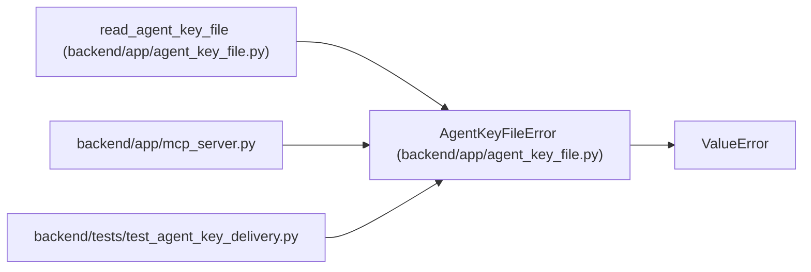

# AgentKeyFileError

**Location:** `backend/app/agent_key_file.py:14`
**Kind:** Class
**Bases:** `ValueError`
**Module:** [agent_key_file](../modules/agent_key_file.md)

## Description

Raised when a key file is missing, unsafe, or malformed.

Messages name the path and the problem only; they never include file content.

## Attributes

*No annotated attributes found.*

## Methods

*No declared methods.*

## Relationships

<!-- Auto-generated relationship summary. Do not edit by hand. -->

### Summary

| Module | Methods | Attributes |
|---|---:|---|
| [agent_key_file](../modules/agent_key_file.md) | 0 | — |

### Structure

| Kind | Entity | Module |
|---|---|---|
| Base | `ValueError` | — |

### References

| Reference | Kind | Source | Call sites |
|---|---|---|---:|
| `read_agent_key_file` | call | [agent_key_file](../modules/agent_key_file.md) | 6 |
| `mcp_server` | import | [mcp_server](../modules/mcp_server.md) | — |
| `test_agent_key_delivery` | import | [test_agent_key_delivery](../modules/test_agent_key_delivery.md) | — |
