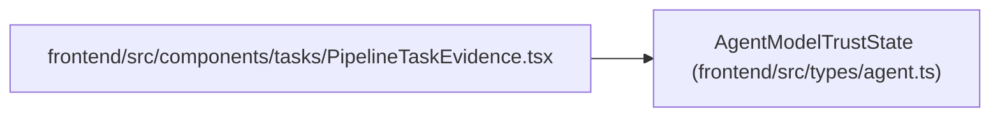

# AgentModelTrustState

**Location:** `frontend/src/types/agent.ts:12`
**Kind:** Type alias
**Bases:** —
**Module:** [types_agent](../modules/types_agent.md)
**Target:**

```typescript
'matched' | 'mismatch' | 'unreported' | 'unverifiable'
```

## Description

_Auto-generated from `AgentModelTrustState` in `frontend/src/types/agent.ts`._

## Attributes

*See the alias definition for its member types.*

## Methods

*See the alias definition for callable and member types.*

## Relationships

<!-- Auto-generated relationship summary. Do not edit by hand. -->


### Summary

| Module | Methods | Attributes |
|---|---:|---|
| [types_agent](../modules/types_agent.md) | 0 | — |

### References

| Reference | Kind | Source | Call sites |
|---|---|---|---:|
| `PipelineTaskEvidence` | import | [PipelineTaskEvidence](../modules/PipelineTaskEvidence.md) | — |
