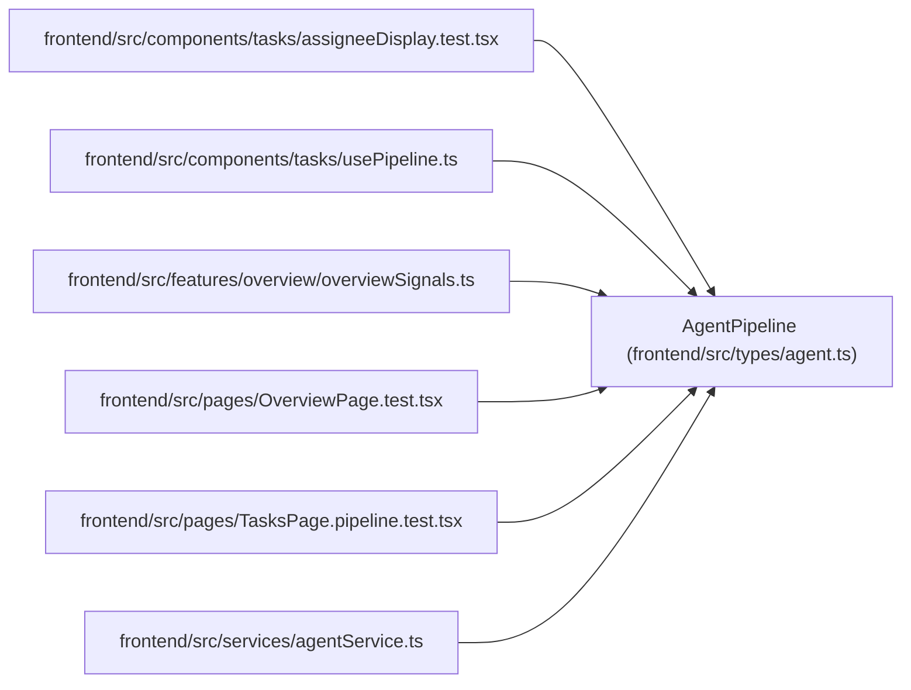

# AgentPipeline

**Location:** `frontend/src/types/agent.ts:633`
**Kind:** Interface
**Bases:** —
**Module:** [types_agent](../modules/types_agent.md)

## Description

_Auto-generated from `AgentPipeline` in `frontend/src/types/agent.ts`._

## Attributes

| Name | Type | Required | Default | Description |
|------|------|----------|---------|-------------|
| `needs_definition` | `Task[]` | Yes | — | — |
| `ready_to_assign` | `Task[]` | Yes | — | — |
| `assigned_waiting` | `Task[]` | Yes | — | — |
| `start_ready` | `Task[]` | Yes | — | — |
| `executing` | `Task[]` | Yes | — | — |
| `active_outside_run` | `Task[]` | No | — | — |
| `verification_required` | `Task[]` | Yes | — | — |
| `recovery_required` | `Task[]` | Yes | — | — |

## Methods

*No declared methods.*

## Relationships

<!-- Auto-generated relationship summary. Do not edit by hand. -->

### Summary

| Module | Methods | Attributes |
|---|---:|---|
| [types_agent](../modules/types_agent.md) | 0 | `active_outside_run`, `assigned_waiting`, `executing`, `needs_definition`, `ready_to_assign`, `recovery_required`, `start_ready`, `verification_required` |

### References

| Reference | Kind | Source | Call sites |
|---|---|---|---:|
| `assigneeDisplay.test` | import | [assigneeDisplay.test](../modules/assigneeDisplay.test.md) | — |
| `usePipeline` | import | [usePipeline](../modules/usePipeline.md) | — |
| `overviewSignals` | import | [overviewSignals](../modules/overviewSignals.md) | — |
| `OverviewPage.test` | import | [OverviewPage.test](../modules/OverviewPage.test.md) | — |
| `TasksPage.pipeline.test` | import | [TasksPage.pipeline.test](../modules/TasksPage.pipeline.test.md) | — |
| `agentService` | import | [agentService](../modules/agentService.md) | — |
