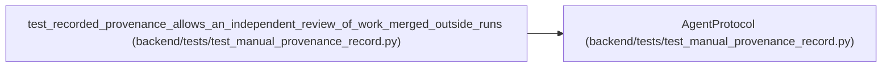

# AgentProtocol

**Location:** `backend/tests/test_manual_provenance_record.py:72`
**Kind:** Class
**Bases:** —
**Module:** [test_manual_provenance_record](../modules/test_manual_provenance_record.md)

## Description

Call agent commands over REST or MCP with the planning command headers.

## Attributes

*No annotated attributes found.*

## Methods

| Method | Signature | Decorators | Description |
|--------|-----------|------------|-------------|
| `__init__` | `(transport, factory, monkeypatch)` | — | — |
| `__aenter__` | *(async)* `()` | — | — |
| `__aexit__` | *(async)* `(*exc)` | — | — |
| `__call__` | *(async)* `(tool, path, key, *, payload, receipt, task_id = None, error = None)` | — | — |

## Relationships

<!-- Auto-generated relationship summary. Do not edit by hand. -->

### Summary

| Module | Methods | Attributes |
|---|---:|---|
| [test_manual_provenance_record](../modules/test_manual_provenance_record.md) | 4 | — |

### References

| Reference | Kind | Source | Call sites |
|---|---|---|---:|
| `test_recorded_provenance_allows_an_independent_review_of_work_merged_outside_runs` | call | [test_manual_provenance_record](../modules/test_manual_provenance_record.md) | 1 |
