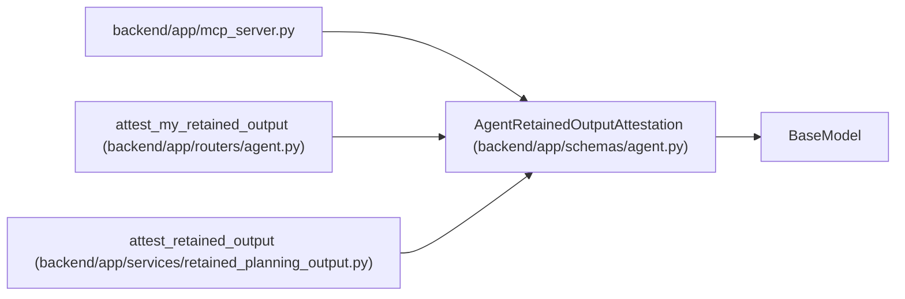

# AgentRetainedOutputAttestation

**Location:** `backend/app/schemas/agent.py:1300`
**Kind:** Pydantic model
**Bases:** `BaseModel`
**Module:** [schemas_agent](../modules/schemas_agent.md)

## Description

A fresh statement from the original worker after a genuine expiry and PM recovery.

The worker confirms the original run, assignment, generation, planning and recovery receipts, source commit, tree and native turn. WorkChord compares that statement with the pre-expiry checkpoint before adding it to the independent reviewer’s contributor history.

## Model Configuration

| Setting | Value | Source |
|---------|-------|--------|
| `extra` | `'forbid'` | model_config |

## Attributes

| Name | Type | Wire name | Required | Nullable | Default | Constraints | Examples | Description |
|------|------|-----------|----------|----------|---------|-------------|-------------|----------|
| `assignment_id` | `int` | `assignment_id` | Yes | No | — | gt=0 | — | — |
| `claim_generation` | `int` | `claim_generation` | Yes | No | — | ge=1 | — | — |
| `claim_id` | `str` | `claim_id` | Yes | No | — | min_length=16; max_length=64 | — | — |
| `planning_receipt_id` | `int \| None` | `planning_receipt_id` | No | Yes | `None` | gt=0 | — | — |
| `planning_actor_id` | `int \| None` | `planning_actor_id` | No | Yes | `None` | gt=0 | — | — |
| `planning_command_key` | `str \| None` | `planning_command_key` | No | Yes | `None` | min_length=1; max_length=255 | — | — |
| `recovery_receipt_id` | `int \| None` | `recovery_receipt_id` | No | Yes | `None` | gt=0 | — | — |
| `recovery_actor_id` | `int \| None` | `recovery_actor_id` | No | Yes | `None` | gt=0 | — | — |
| `recovery_command_key` | `str \| None` | `recovery_command_key` | No | Yes | `None` | min_length=1; max_length=255 | — | — |
| `checkpoint_id` | `int` | `checkpoint_id` | Yes | No | — | gt=0 | — | — |
| `observed_model` | `str` | `observed_model` | Yes | No | — | min_length=1; max_length=255 | — | — |
| `commit_url` | `str` | `commit_url` | Yes | No | — | min_length=1; max_length=2048 | — | — |
| `pr_url` | `str` | `pr_url` | Yes | No | — | min_length=1; max_length=2048 | — | — |
| `git_tree` | `str` | `git_tree` | Yes | No | — | pattern='^[0-9a-f]{40}([0-9a-f]{24})?$' | — | — |
| `terminal_native_turn` | `str` | `terminal_native_turn` | Yes | No | — | min_length=1; max_length=255 | — | — |
| `confirmed_final_output` | `Literal[True]` | `confirmed_final_output` | Yes | No | — | — | — | — |

## Methods

*No declared methods.*

## Relationships

<!-- Auto-generated relationship summary. Do not edit by hand. -->

### Summary

| Module | Methods | Attributes |
|---|---:|---|
| [schemas_agent](../modules/schemas_agent.md) | 0 | `assignment_id`, `checkpoint_id`, `claim_generation`, `claim_id`, `commit_url`, `confirmed_final_output`, `git_tree`, `observed_model`, `planning_actor_id`, `planning_command_key`, `planning_receipt_id`, `pr_url` |

### Structure

| Kind | Entity | Module |
|---|---|---|
| Base | `BaseModel` | — |

### References

| Reference | Kind | Source | Call sites |
|---|---|---|---:|
| `mcp_server` | import | [mcp_server](../modules/mcp_server.md) | — |
| `attest_my_retained_output` | type_reference | [routers_agent](../modules/routers_agent.md) | — |
| `attest_retained_output` | type_reference | [retained_planning_output](../modules/retained_planning_output.md) | — |
