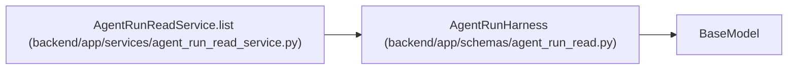

# AgentRunHarness

**Location:** `backend/app/schemas/agent_run_read.py:12`
**Kind:** Pydantic model
**Bases:** `BaseModel`
**Module:** [agent_run_read](../modules/agent_run_read.md)

## Description

The harness session the actor declared at begin; never verified.

## Attributes

| Name | Type | Wire name | Required | Nullable | Default | Constraints | Examples | Description |
|------|------|-----------|----------|----------|---------|-------------|-------------|----------|
| `kind` | `str` | `kind` | Yes | No | — | — | — | — |
| `session_id` | `str` | `session_id` | Yes | No | — | — | — | — |

## Methods

*No declared methods.*

## Relationships

<!-- Auto-generated relationship summary. Do not edit by hand. -->

### Summary

| Module | Methods | Attributes |
|---|---:|---|
| [agent_run_read](../modules/agent_run_read.md) | 0 | `kind`, `session_id` |

### Structure

| Kind | Entity | Module |
|---|---|---|
| Base | `BaseModel` | — |

### References

| Reference | Kind | Source | Call sites |
|---|---|---|---:|
| `AgentRunReadService.list` | call | [agent_run_read_service](../modules/agent_run_read_service.md) | 1 |
