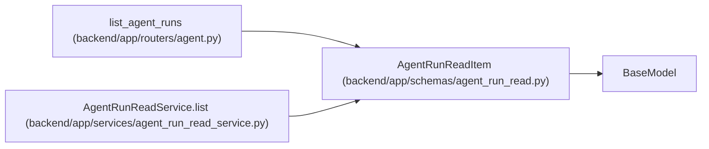

# AgentRunReadItem

**Location:** `backend/app/schemas/agent_run_read.py:19`
**Kind:** Pydantic model
**Bases:** `BaseModel`
**Module:** [agent_run_read](../modules/agent_run_read.md)

## Description

One run, for people, observers, operators and planning agents.

Run events, logs, artifacts, summaries and errors stay with run detail,
which needs the admin key or an agent key.

## Attributes

| Name | Type | Wire name | Required | Nullable | Default | Constraints | Examples | Description |
|------|------|-----------|----------|----------|---------|-------------|-------------|----------|
| `id` | `int` | `id` | Yes | No | — | — | — | — |
| `task_id` | `Optional[int]` | `task_id` | No | Yes | `None` | — | — | — |
| `assignment_id` | `Optional[int]` | `assignment_id` | No | Yes | `None` | — | — | — |
| `actor_id` | `int` | `actor_id` | Yes | No | — | — | — | — |
| `actor` | `Optional[AgentAssignmentActorSummary]` | `actor` | No | Yes | `None` | — | — | — |
| `status` | `str` | `status` | Yes | No | — | — | — | — |
| `trace_id` | `Optional[str]` | `trace_id` | No | Yes | `None` | — | — | — |
| `harness` | `Optional[AgentRunHarness]` | `harness` | No | Yes | `None` | — | — | — |
| `model` | `Optional[str]` | `model` | No | Yes | `None` | — | — | — |
| `configured_model_alias` | `Optional[str]` | `configured_model_alias` | No | Yes | `None` | — | — | — |
| `resolved_model_id` | `Optional[str]` | `resolved_model_id` | No | Yes | `None` | — | — | — |
| `model_trust_state` | `str` | `model_trust_state` | Yes | No | — | — | — | — |
| `started_at` | `datetime` | `started_at` | Yes | No | — | — | — | — |
| `heartbeat_at` | `Optional[datetime]` | `heartbeat_at` | No | Yes | `None` | — | — | — |
| `ended_at` | `Optional[datetime]` | `ended_at` | No | Yes | `None` | — | — | — |
| `usage` | `Optional[ExecutionUsageResponse]` | `usage` | No | Yes | `None` | — | — | — |

## Methods

*No declared methods.*

## Relationships

<!-- Auto-generated relationship summary. Do not edit by hand. -->

### Summary

| Module | Methods | Attributes |
|---|---:|---|
| [agent_run_read](../modules/agent_run_read.md) | 0 | `actor`, `actor_id`, `assignment_id`, `configured_model_alias`, `ended_at`, `harness`, `heartbeat_at`, `id`, `model`, `model_trust_state`, `resolved_model_id`, `started_at` |

### Structure

| Kind | Entity | Module |
|---|---|---|
| Base | `BaseModel` | — |

### References

| Reference | Kind | Source | Call sites |
|---|---|---|---:|
| `list_agent_runs` | type_reference | [routers_agent](../modules/routers_agent.md) | — |
| `AgentRunReadService.list` | call | [agent_run_read_service](../modules/agent_run_read_service.md) | 1 |
| `AgentRunReadService.list` | type_reference | [agent_run_read_service](../modules/agent_run_read_service.md) | — |
