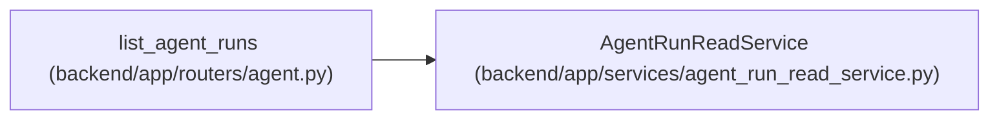

# AgentRunReadService

**Location:** `backend/app/services/agent_run_read_service.py:13`
**Kind:** Class
**Bases:** —
**Module:** [agent_run_read_service](../modules/agent_run_read_service.md)

## Description

_Auto-generated from `AgentRunReadService` in `backend/app/services/agent_run_read_service.py`._

## Attributes

*No annotated attributes found.*

## Methods

| Method | Signature | Decorators | Description |
|--------|-----------|------------|-------------|
| `__init__` | `(db)` | — | — |
| `list` | *(async)* `(*, task_id = None, harness_kind = None, harness_session_id = None, status = None, actor_id = None, limit = 50) -> list[AgentRunReadItem]` | — | Runs of the tasks this request's reader can see, newest first. |

## Relationships

<!-- Auto-generated relationship summary. Do not edit by hand. -->

### Summary

| Module | Methods | Attributes |
|---|---:|---|
| [agent_run_read_service](../modules/agent_run_read_service.md) | 2 | — |

### References

| Reference | Kind | Source | Call sites |
|---|---|---|---:|
| `list_agent_runs` | call | [routers_agent](../modules/routers_agent.md) | 1 |
