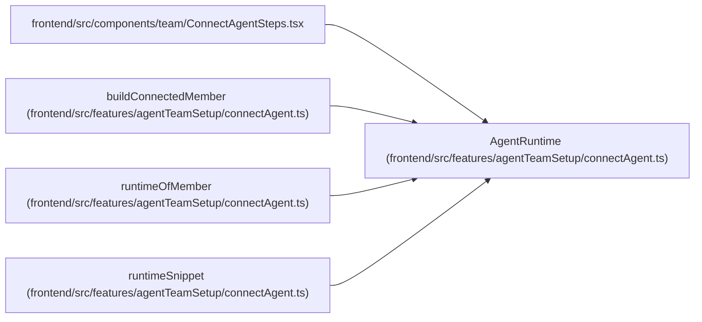

# AgentRuntime

**Location:** `frontend/src/features/agentTeamSetup/connectAgent.ts:6`
**Kind:** Type alias
**Bases:** —
**Module:** [connectAgent](../modules/connectAgent.md)
**Target:**

```typescript
(typeof AGENT_RUNTIMES)[number]
```

## Description

_Auto-generated from `AgentRuntime` in `frontend/src/features/agentTeamSetup/connectAgent.ts`._

## Attributes

*See the alias definition for its member types.*

## Methods

*See the alias definition for callable and member types.*

## Relationships

<!-- Auto-generated relationship summary. Do not edit by hand. -->


### Summary

| Module | Methods | Attributes |
|---|---:|---|
| [connectAgent](../modules/connectAgent.md) | 0 | — |

### References

| Reference | Kind | Source | Call sites |
|---|---|---|---:|
| `ConnectAgentSteps` | import | [ConnectAgentSteps](../modules/ConnectAgentSteps.md) | — |
| `buildConnectedMember` | type_reference | [connectAgent](../modules/connectAgent.md) | — |
| `runtimeOfMember` | type_reference | [connectAgent](../modules/connectAgent.md) | — |
| `runtimeSnippet` | type_reference | [connectAgent](../modules/connectAgent.md) | — |
