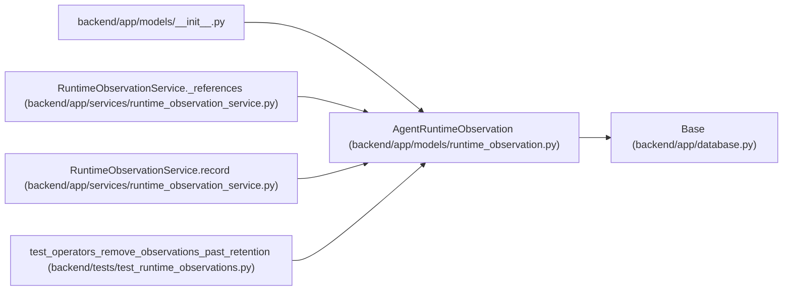

# AgentRuntimeObservation

**Location:** `backend/app/models/runtime_observation.py:14`
**Kind:** Class
**Bases:** `Base`
**Module:** [models_runtime_observation](../modules/models_runtime_observation.md)

## Description

What an independent observer saw of an agent runtime session.

Advisory only: no dispatch, routing, readiness, assignment or work decision
reads this table, and recording a row writes nothing else. Rows are never
edited; operator cleanup removes rows past the retention period.

## Attributes

| Name | Type | Default | Description |
|------|------|---------|-------------|
| `id` | `Mapped[int]` | `mapped_column(Integer, primary_key=True)` | — |
| `task_id` | `Mapped[int \| None]` | `mapped_column(ForeignKey('tasks.id', ondelete='SET NULL'), index=True)` | — |
| `run_id` | `Mapped[int \| None]` | `mapped_column(ForeignKey('agent_runs.id', ondelete='SET NULL'), index=True)` | — |
| `subject_actor_id` | `Mapped[int \| None]` | `mapped_column(ForeignKey('agent_actors.id', ondelete='SET NULL'))` | — |
| `observer_session_id` | `Mapped[int \| None]` | `mapped_column(ForeignKey('user_sessions.id', ondelete='SET NULL'))` | — |
| `observer_principal_id` | `Mapped[int \| None]` | `mapped_column(ForeignKey('principals.id', ondelete='SET NULL'))` | — |
| `observer_label` | `Mapped[str \| None]` | `mapped_column(String(80))` | — |
| `kind` | `Mapped[str]` | `mapped_column(String(30), nullable=False)` | — |
| `harness_kind` | `Mapped[str]` | `mapped_column(String(40), nullable=False)` | — |
| `harness_session_id` | `Mapped[str]` | `mapped_column(String(255), nullable=False)` | — |
| `observed_model` | `Mapped[str \| None]` | `mapped_column(String(255))` | — |
| `idempotency_key` | `Mapped[str]` | `mapped_column(String(128), nullable=False)` | — |
| `observed_at` | `Mapped[datetime]` | `mapped_column(UTCDateTime(), nullable=False)` | — |
| `received_at` | `Mapped[datetime]` | `mapped_column(UTCDateTime(), default=utc_now, nullable=False)` | — |

## Methods

*No declared methods.*

## Relationships

<!-- Auto-generated relationship summary. Do not edit by hand. -->

### Summary

| Module | Methods | Attributes |
|---|---:|---|
| [models_runtime_observation](../modules/models_runtime_observation.md) | 0 | `harness_kind`, `harness_session_id`, `id`, `idempotency_key`, `kind`, `observed_at`, `observed_model`, `observer_label`, `observer_principal_id`, `observer_session_id`, `received_at`, `run_id` |

### Structure

| Kind | Entity | Module |
|---|---|---|
| Base | `Base` | [app_database](../modules/app_database.md) |

### References

| Reference | Kind | Source | Call sites |
|---|---|---|---:|
| `__init__` | import | [models___init__](../modules/models___init__.md) | — |
| `RuntimeObservationService._references` | type_reference | [runtime_observation_service](../modules/runtime_observation_service.md) | — |
| `RuntimeObservationService.record` | call | [runtime_observation_service](../modules/runtime_observation_service.md) | 1 |
| `RuntimeObservationService.record` | type_reference | [runtime_observation_service](../modules/runtime_observation_service.md) | — |
| `test_operators_remove_observations_past_retention` | call | [test_runtime_observations](../modules/test_runtime_observations.md) | 1 |
