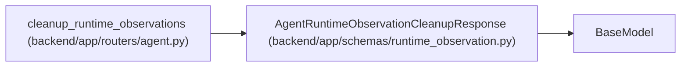

# AgentRuntimeObservationCleanupResponse

**Location:** `backend/app/schemas/runtime_observation.py:73`
**Kind:** Pydantic model
**Bases:** `BaseModel`
**Module:** [schemas_runtime_observation](../modules/schemas_runtime_observation.md)

## Description

_Auto-generated from `AgentRuntimeObservationCleanupResponse` in `backend/app/schemas/runtime_observation.py`._

## Attributes

| Name | Type | Wire name | Required | Nullable | Default | Constraints | Examples | Description |
|------|------|-----------|----------|----------|---------|-------------|-------------|----------|
| `removed` | `int` | `removed` | Yes | No | — | — | — | — |
| `retention_days` | `int` | `retention_days` | Yes | No | — | — | — | — |
| `limit` | `int` | `limit` | Yes | No | — | — | — | — |

## Methods

*No declared methods.*

## Relationships

<!-- Auto-generated relationship summary. Do not edit by hand. -->

### Summary

| Module | Methods | Attributes |
|---|---:|---|
| [schemas_runtime_observation](../modules/schemas_runtime_observation.md) | 0 | `limit`, `removed`, `retention_days` |

### Structure

| Kind | Entity | Module |
|---|---|---|
| Base | `BaseModel` | — |

### References

| Reference | Kind | Source | Call sites |
|---|---|---|---:|
| `cleanup_runtime_observations` | type_reference | [routers_agent](../modules/routers_agent.md) | — |
