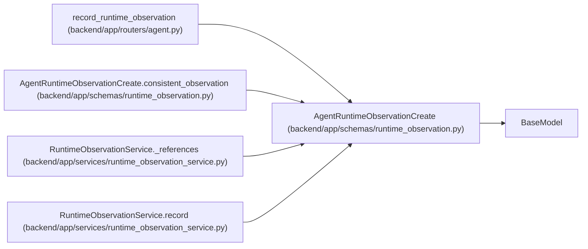

# AgentRuntimeObservationCreate

**Location:** `backend/app/schemas/runtime_observation.py:14`
**Kind:** Pydantic model
**Bases:** `BaseModel`
**Module:** [schemas_runtime_observation](../modules/schemas_runtime_observation.md)

## Description

One thing an independent observer saw of a runtime session.

``model_observed`` carries the model the observer saw the session use;
the other kinds describe the session's state.

## Model Configuration

| Setting | Value | Source |
|---------|-------|--------|
| `extra` | `'forbid'` | model_config |

## Validators

| Method | Scope | Fields | Mode | Options |
|--------|-------|--------|------|---------|
| `bounded_observation_time` | field | observed_at | after | — |
| `consistent_observation` | model | — | after | — |

## Attributes

| Name | Type | Wire name | Required | Nullable | Default | Constraints | Examples | Description |
|------|------|-----------|----------|----------|---------|-------------|-------------|----------|
| `kind` | `ObservationKind` | `kind` | Yes | No | — | — | — | — |
| `harness_kind` | `str` | `harness_kind` | Yes | No | — | min_length=1; max_length=40 | — | — |
| `harness_session_id` | `str` | `harness_session_id` | Yes | No | — | min_length=1; max_length=255 | — | — |
| `observed_at` | `datetime` | `observed_at` | Yes | No | — | — | — | — |
| `idempotency_key` | `str` | `idempotency_key` | Yes | No | — | min_length=1; max_length=128; pattern='^[A-Za-z0-9._:-]+$' | — | — |
| `task_id` | `Optional[int]` | `task_id` | No | Yes | `None` | ge=1 | — | — |
| `run_id` | `Optional[int]` | `run_id` | No | Yes | `None` | ge=1 | — | — |
| `subject_actor_id` | `Optional[int]` | `subject_actor_id` | No | Yes | `None` | ge=1 | — | — |
| `observed_model` | `Optional[str]` | `observed_model` | No | Yes | `None` | min_length=1; max_length=255 | — | — |

## Methods

| Method | Signature | Decorators | Description |
|--------|-----------|------------|-------------|
| `bounded_observation_time` | `(value: datetime) -> datetime` | `@field_validator('observed_at')`, `@classmethod` | — |
| `consistent_observation` | `() -> 'AgentRuntimeObservationCreate'` | `@model_validator(mode='after')` | — |

## Relationships

<!-- Auto-generated relationship summary. Do not edit by hand. -->

### Summary

| Module | Methods | Attributes |
|---|---:|---|
| [schemas_runtime_observation](../modules/schemas_runtime_observation.md) | 2 | `harness_kind`, `harness_session_id`, `idempotency_key`, `kind`, `observed_at`, `observed_model`, `run_id`, `subject_actor_id`, `task_id` |

### Structure

| Kind | Entity | Module |
|---|---|---|
| Base | `BaseModel` | — |

### References

| Reference | Kind | Source | Call sites |
|---|---|---|---:|
| `record_runtime_observation` | type_reference | [routers_agent](../modules/routers_agent.md) | — |
| `AgentRuntimeObservationCreate.consistent_observation` | type_reference | [schemas_runtime_observation](../modules/schemas_runtime_observation.md) | — |
| `RuntimeObservationService._references` | type_reference | [runtime_observation_service](../modules/runtime_observation_service.md) | — |
| `RuntimeObservationService.record` | type_reference | [runtime_observation_service](../modules/runtime_observation_service.md) | — |
