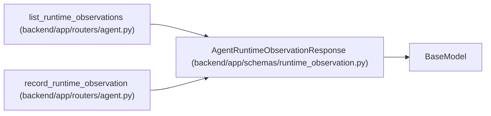

# AgentRuntimeObservationResponse

**Location:** `backend/app/schemas/runtime_observation.py:53`
**Kind:** Pydantic model
**Bases:** `BaseModel`
**Module:** [schemas_runtime_observation](../modules/schemas_runtime_observation.md)

## Description

A recorded observation. It is advisory and never affects dispatch.

## Model Configuration

| Setting | Value | Source |
|---------|-------|--------|
| `from_attributes` | `True` | model_config |

## Attributes

| Name | Type | Wire name | Required | Nullable | Default | Constraints | Examples | Description |
|------|------|-----------|----------|----------|---------|-------------|-------------|----------|
| `id` | `int` | `id` | Yes | No | — | — | — | — |
| `kind` | `ObservationKind` | `kind` | Yes | No | — | — | — | — |
| `harness_kind` | `str` | `harness_kind` | Yes | No | — | — | — | — |
| `harness_session_id` | `str` | `harness_session_id` | Yes | No | — | — | — | — |
| `task_id` | `Optional[int]` | `task_id` | No | Yes | `None` | — | — | — |
| `run_id` | `Optional[int]` | `run_id` | No | Yes | `None` | — | — | — |
| `subject_actor_id` | `Optional[int]` | `subject_actor_id` | No | Yes | `None` | — | — | — |
| `observed_model` | `Optional[str]` | `observed_model` | No | Yes | `None` | — | — | — |
| `observer_label` | `Optional[str]` | `observer_label` | No | Yes | `None` | — | — | — |
| `observed_at` | `datetime` | `observed_at` | Yes | No | — | — | — | — |
| `received_at` | `datetime` | `received_at` | Yes | No | — | — | — | — |
| `advisory` | `Literal[True]` | `advisory` | No | No | `True` | — | — | — |
| `affects_dispatch` | `Literal[False]` | `affects_dispatch` | No | No | `False` | — | — | — |

## Methods

*No declared methods.*

## Relationships

<!-- Auto-generated relationship summary. Do not edit by hand. -->

### Summary

| Module | Methods | Attributes |
|---|---:|---|
| [schemas_runtime_observation](../modules/schemas_runtime_observation.md) | 0 | `advisory`, `affects_dispatch`, `harness_kind`, `harness_session_id`, `id`, `kind`, `observed_at`, `observed_model`, `observer_label`, `received_at`, `run_id`, `subject_actor_id` |

### Structure

| Kind | Entity | Module |
|---|---|---|
| Base | `BaseModel` | — |

### References

| Reference | Kind | Source | Call sites |
|---|---|---|---:|
| `list_runtime_observations` | type_reference | [routers_agent](../modules/routers_agent.md) | — |
| `record_runtime_observation` | type_reference | [routers_agent](../modules/routers_agent.md) | — |
