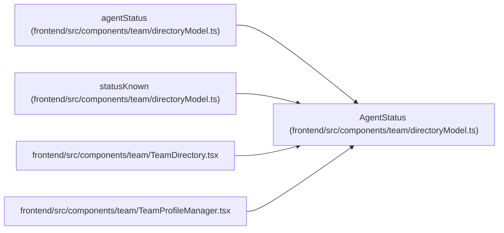

# AgentStatus

**Location:** `frontend/src/components/team/directoryModel.ts:16`
**Kind:** Interface
**Bases:** —
**Module:** [directoryModel](../modules/directoryModel.md)

## Description

What an agent's model and connection cells show.

## Attributes

| Name | Type | Required | Default | Description |
|------|------|----------|---------|-------------|
| `model` | `AgentModelBinding \| null \| undefined` | Yes | — | — |
| `connection` | `ConnectionState` | Yes | — | — |

## Methods

*No declared methods.*

## Relationships

<!-- Auto-generated relationship summary. Do not edit by hand. -->

### Summary

| Module | Methods | Attributes |
|---|---:|---|
| [directoryModel](../modules/directoryModel.md) | 0 | `connection`, `model` |

### References

| Reference | Kind | Source | Call sites |
|---|---|---|---:|
| `agentStatus` | type_reference | [directoryModel](../modules/directoryModel.md) | — |
| `statusKnown` | type_reference | [directoryModel](../modules/directoryModel.md) | — |
| `TeamDirectory` | import | [TeamDirectory](../modules/TeamDirectory.md) | — |
| `TeamProfileManager` | import | [TeamProfileManager](../modules/TeamProfileManager.md) | — |
