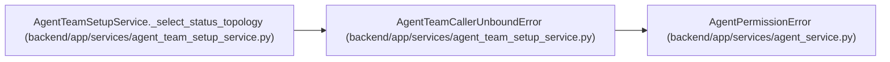

# AgentTeamCallerUnboundError

**Location:** `backend/app/services/agent_team_setup_service.py:126`
**Kind:** Class
**Bases:** `AgentPermissionError`
**Module:** [agent_team_setup_service](../modules/agent_team_setup_service.md)

## Description

A PM asked for team status but is not bound to any live topology.

## Attributes

*No annotated attributes found.*

## Methods

*No declared methods.*

## Relationships

<!-- Auto-generated relationship summary. Do not edit by hand. -->

### Summary

| Module | Methods | Attributes |
|---|---:|---|
| [agent_team_setup_service](../modules/agent_team_setup_service.md) | 0 | — |

### Structure

| Kind | Entity | Module |
|---|---|---|
| Base | `AgentPermissionError` | [agent_service](../modules/agent_service.md) |

### References

| Reference | Kind | Source | Call sites |
|---|---|---|---:|
| `AgentTeamSetupService._select_status_topology` | call | [agent_team_setup_service](../modules/agent_team_setup_service.md) | 1 |
