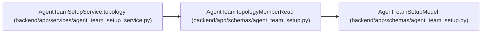

# AgentTeamTopologyMemberRead

**Location:** `backend/app/schemas/agent_team_setup.py:1083`
**Kind:** Pydantic model
**Bases:** `AgentTeamSetupModel`
**Module:** [agent_team_setup](../modules/agent_team_setup.md)

## Description

Which actor a team member is and which runtime reference runs it.

Credential references, handoffs and acknowledgement payloads are never part
of this read.

## Attributes

| Name | Type | Wire name | Required | Nullable | Default | Constraints | Examples | Description |
|------|------|-----------|----------|----------|---------|-------------|-------------|----------|
| `actor_key` | `str` | `actor_key` | Yes | No | — | pattern=unknown (STABLE_KEY_PATTERN) | — | — |
| `actor_id` | `int \| None` | `actor_id` | No | Yes | `None` | ge=1 | — | — |
| `actor_name` | `str` | `actor_name` | Yes | No | — | pattern=unknown (STABLE_KEY_PATTERN) | — | — |
| `display_name` | `str` | `display_name` | Yes | No | — | — | — | — |
| `role` | `Literal['pm', 'worker', 'verifier']` | `role` | Yes | No | — | — | — | — |
| `desired` | `bool` | `desired` | Yes | No | — | — | — | — |
| `lifecycle_state` | `AgentTeamMemberLifecycle` | `lifecycle_state` | Yes | No | — | — | — | — |
| `profile_key` | `str` | `profile_key` | Yes | No | — | pattern=unknown (STABLE_KEY_PATTERN) | — | — |
| `runtime_ready` | `bool` | `runtime_ready` | Yes | No | — | — | — | — |
| `model_binding_keys` | `tuple[str, ...]` | `model_binding_keys` | No | No | `()` | max_length=16 | — | — |
| `default_model_binding_key` | `str \| None` | `default_model_binding_key` | No | Yes | `None` | — | — | — |
| `runtime_ref` | `str` | `runtime_ref` | Yes | No | — | max_length=1024; min_length=1 | — | — |

## Methods

*No declared methods.*

## Relationships

<!-- Auto-generated relationship summary. Do not edit by hand. -->

### Summary

| Module | Methods | Attributes |
|---|---:|---|
| [agent_team_setup](../modules/agent_team_setup.md) | 0 | `actor_id`, `actor_key`, `actor_name`, `default_model_binding_key`, `desired`, `display_name`, `lifecycle_state`, `model_binding_keys`, `profile_key`, `role`, `runtime_ready`, `runtime_ref` |

### Structure

| Kind | Entity | Module |
|---|---|---|
| Base | `AgentTeamSetupModel` | [agent_team_setup](../modules/agent_team_setup.md) |

### References

| Reference | Kind | Source | Call sites |
|---|---|---|---:|
| `AgentTeamSetupService.topology` | call | [agent_team_setup_service](../modules/agent_team_setup_service.md) | 1 |
