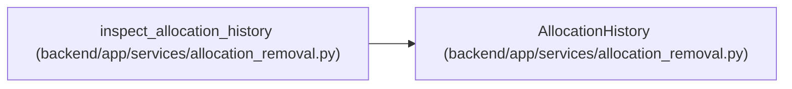

# AllocationHistory

**Location:** `backend/app/services/allocation_removal.py:237`
**Kind:** Class
**Bases:** —
**Module:** [allocation_removal](../modules/allocation_removal.md)

**Decorators:** `@dataclass(frozen=True)`

## Description

_Auto-generated from `AllocationHistory` in `backend/app/services/allocation_removal.py`._

This observation binds retained history to the planning revision recorded before the standalone deletion reserves the writer. A direct reference can skip the expensive history read. A current observation of unused history is required to preserve unrelated task versions.

## Attributes

| Name | Type | Default | Description |
|------|------|---------|-------------|
| `revision` | `int` | *required* | — |
| `unused` | `bool \| None` | *required* | — |

## Methods

*No declared methods.*

## Relationships

<!-- Auto-generated relationship summary. Do not edit by hand. -->

### Summary

| Module | Methods | Attributes |
|---|---:|---|
| [allocation_removal](../modules/allocation_removal.md) | 0 | `revision`, `unused` |

### References

| Reference | Kind | Source | Call sites |
|---|---|---|---:|
| `inspect_allocation_history` | call | [allocation_removal](../modules/allocation_removal.md) | 4 |
