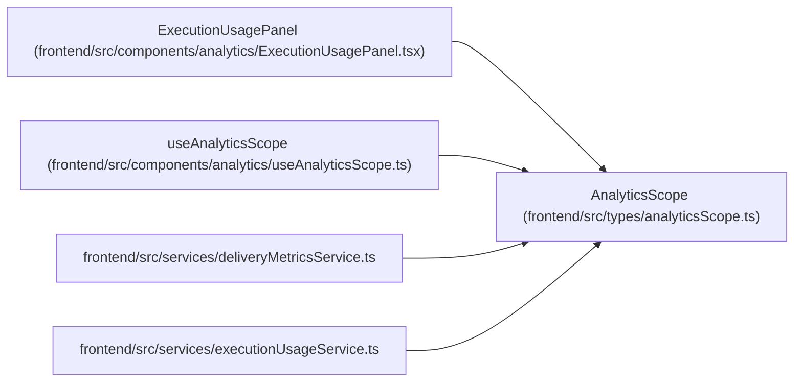

# AnalyticsScope

**Location:** `frontend/src/types/analyticsScope.ts:1`
**Kind:** Interface
**Bases:** —
**Module:** [analyticsScope](../modules/analyticsScope.md)

## Description

_Auto-generated from `AnalyticsScope` in `frontend/src/types/analyticsScope.ts`._

## Attributes

| Name | Type | Required | Default | Description |
|------|------|----------|---------|-------------|
| `project_id` | `number` | No | — | — |
| `iteration_id` | `number` | No | — | — |
| `backlog` | `boolean` | No | — | — |
| `all_projects` | `boolean` | No | — | — |
| `all_projects_backlog` | `boolean` | No | — | — |
| `lookback_days` | `number` | Yes | — | — |

## Methods

*No declared methods.*

## Relationships

<!-- Auto-generated relationship summary. Do not edit by hand. -->

### Summary

| Module | Methods | Attributes |
|---|---:|---|
| [analyticsScope](../modules/analyticsScope.md) | 0 | `all_projects`, `all_projects_backlog`, `backlog`, `iteration_id`, `lookback_days`, `project_id` |

### References

| Reference | Kind | Source | Call sites |
|---|---|---|---:|
| `ExecutionUsagePanel` | type_reference | [ExecutionUsagePanel](../modules/ExecutionUsagePanel.md) | — |
| `useAnalyticsScope` | type_reference | [useAnalyticsScope](../modules/useAnalyticsScope.md) | — |
| `deliveryMetricsService` | import | [deliveryMetricsService](../modules/deliveryMetricsService.md) | — |
| `executionUsageService` | import | [executionUsageService](../modules/executionUsageService.md) | — |
