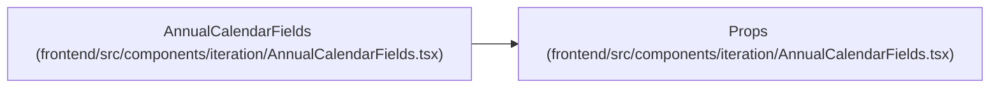

# Props

**Location:** `frontend/src/components/iteration/AnnualCalendarFields.tsx:5`
**Kind:** Interface
**Bases:** —
**Module:** [AnnualCalendarFields](../modules/AnnualCalendarFields.md)

## Description

_Auto-generated from `Props` in `frontend/src/components/iteration/AnnualCalendarFields.tsx`._

## Attributes

| Name | Type | Required | Default | Description |
|------|------|----------|---------|-------------|
| `calendars` | `Calendar[]` | Yes | — | — |
| `primary` | `Calendar` | No | — | — |
| `startDate` | `string` | Yes | — | — |
| `endDate` | `string` | Yes | — | — |
| `selected` | `number[]` | Yes | — | — |
| `onChange` | `(ids: number[]) => void` | Yes | — | — |
| `disabled` | `boolean` | No | — | — |

## Methods

*No declared methods.*

## Relationships

<!-- Auto-generated relationship summary. Do not edit by hand. -->

### Summary

| Module | Methods | Attributes |
|---|---:|---|
| [AnnualCalendarFields](../modules/AnnualCalendarFields.md) | 0 | `calendars`, `disabled`, `endDate`, `onChange`, `primary`, `selected`, `startDate` |

### References

| Reference | Kind | Source | Call sites |
|---|---|---|---:|
| `AnnualCalendarFields` | type_reference | [AnnualCalendarFields](../modules/AnnualCalendarFields.md) | — |
