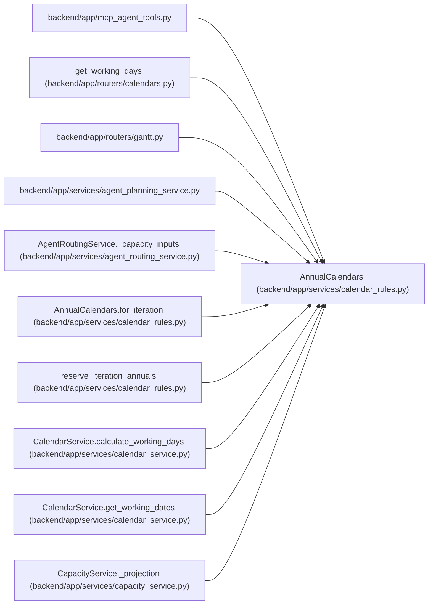

# AnnualCalendars

**Location:** `backend/app/services/calendar_rules.py:63`
**Kind:** Class
**Bases:** —
**Module:** [calendar_rules](../modules/calendar_rules.md)

## Description

A primary calendar and explicitly selected years in the owner's local time zone.

An annual selection belongs to one iteration or profile. The lookup uses the calendar explicitly assigned to the date's year. Replacement checks compare the selected record identity and its actual rules.

## Attributes

*No annotated attributes found.*

## Methods

| Method | Signature | Decorators | Description |
|--------|-----------|------------|-------------|
| `__init__` | `(primary: Calendar, additional = ())` | — | — |
| `for_iteration` | `(iteration)` | `@classmethod` | — |
| `missing_years` | `(start: date, end: date) -> list[int]` | — | — |
| `signature` | `() -> list[dict]` | — | Stable JSON-native inputs for both planning and routing evidence hashes. |
| `replaced_years` | `(updated) -> set[int]` | — | — |
| `hours` | `(day: date) -> float \| None` | — | — |
| `dated_rules` | `(start: date, end: date)` | — | — |
| `period_totals` | `(start: date, end: date)` | — | — |
| `working_dates` | `(start: date, end: date) -> list[date]` | — | — |

## Relationships

<!-- Auto-generated relationship summary. Do not edit by hand. -->

### Summary

| Module | Methods | Attributes |
|---|---:|---|
| [calendar_rules](../modules/calendar_rules.md) | 9 | — |

### References

| Reference | Kind | Source | Call sites |
|---|---|---|---:|
| `mcp_agent_tools` | import | [mcp_agent_tools](../modules/mcp_agent_tools.md) | — |
| `get_working_days` | call | [calendars](../modules/calendars.md) | 1 |
| `gantt` | import | [routers_gantt](../modules/routers_gantt.md) | — |
| `agent_planning_service` | import | [agent_planning_service](../modules/agent_planning_service.md) | — |
| `AgentRoutingService._capacity_inputs` | call | [agent_routing_service](../modules/agent_routing_service.md) | 1 |
| `AnnualCalendars.for_iteration` | call | [calendar_rules](../modules/calendar_rules.md) | 1 |
| `reserve_iteration_annuals` | call | [calendar_rules](../modules/calendar_rules.md) | 1 |
| `CalendarService.calculate_working_days` | call | [calendar_service](../modules/calendar_service.md) | 1 |
| `CalendarService.calculate_working_days` | type_reference | [calendar_service](../modules/calendar_service.md) | — |
| `CalendarService.get_working_dates` | call | [calendar_service](../modules/calendar_service.md) | 1 |
| `CalendarService.get_working_dates` | type_reference | [calendar_service](../modules/calendar_service.md) | — |
| `CapacityService._projection` | call | [capacity_service](../modules/capacity_service.md) | 1 |

> References: showing 12 of 17 logical references; 5 omitted by the 12-row generated summary limit.
