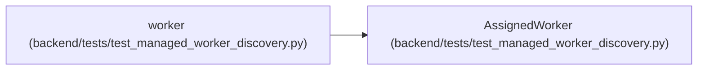

# AssignedWorker

**Location:** `backend/tests/test_managed_worker_discovery.py:42`
**Kind:** Class
**Bases:** —
**Module:** [test_managed_worker_discovery](../modules/test_managed_worker_discovery.md)

**Decorators:** `@dataclass`

## Description

Test fixture value for a worker that has begun its assigned task: the session factory, an authenticated HTTP client and headers, the begin response, and the worker's actor and principal ids plus a second actor used for cross-actor checks.

## Attributes

| Name | Type | Default | Description |
|------|------|---------|-------------|
| `factory` | `async_sessionmaker[AsyncSession]` | *required* | — |
| `client` | `httpx.AsyncClient` | *required* | — |
| `headers` | `dict[str, str]` | *required* | — |
| `begun` | `dict` | *required* | — |
| `actor_id` | `int` | *required* | — |
| `principal_id` | `int` | *required* | — |
| `other_actor_id` | `int` | *required* | — |

## Methods

*No declared methods.*

## Relationships

<!-- Auto-generated relationship summary. Do not edit by hand. -->

### Summary

| Module | Methods | Attributes |
|---|---:|---|
| [test_managed_worker_discovery](../modules/test_managed_worker_discovery.md) | 0 | `actor_id`, `begun`, `client`, `factory`, `headers`, `other_actor_id`, `principal_id` |

### References

| Reference | Kind | Source | Call sites |
|---|---|---|---:|
| `worker` | call | [test_managed_worker_discovery](../modules/test_managed_worker_discovery.md) | 1 |
| `worker` | type_reference | [test_managed_worker_discovery](../modules/test_managed_worker_discovery.md) | — |
