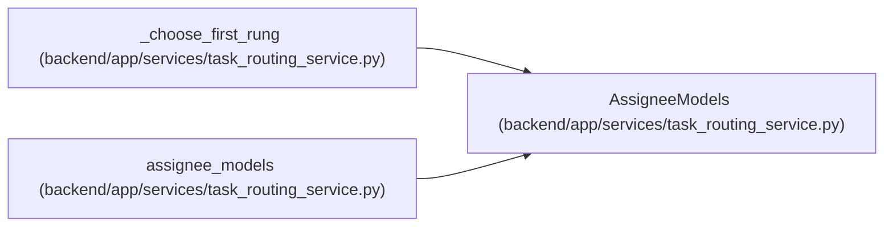

# AssigneeModels

**Location:** `backend/app/services/task_routing_service.py:44`
**Kind:** Class
**Bases:** —
**Module:** [task_routing_service](../modules/task_routing_service.md)

**Decorators:** `@dataclass`

## Description

The catalog entries the assignee row's agents can run.

## Attributes

| Name | Type | Default | Description |
|------|------|---------|-------------|
| `assignee_id` | `int \| None` | `None` | — |
| `profile_id` | `int \| None` | `None` | — |
| `entries` | `list[AgentModelCatalogEntry]` | `field(default_factory=list)` | — |
| `default_keys` | `set[str]` | `field(default_factory=set)` | — |

## Methods

| Method | Signature | Decorators | Description |
|--------|-----------|------------|-------------|
| `keys` | `() -> set[str]` | `@property` | — |
| `publishers` | `() -> set[str]` | `@property` | — |

## Relationships

<!-- Auto-generated relationship summary. Do not edit by hand. -->

### Summary

| Module | Methods | Attributes |
|---|---:|---|
| [task_routing_service](../modules/task_routing_service.md) | 2 | `assignee_id`, `default_keys`, `entries`, `profile_id` |

### References

| Reference | Kind | Source | Call sites |
|---|---|---|---:|
| `_choose_first_rung` | type_reference | [task_routing_service](../modules/task_routing_service.md) | — |
| `assignee_models` | call | [task_routing_service](../modules/task_routing_service.md) | 3 |
| `assignee_models` | type_reference | [task_routing_service](../modules/task_routing_service.md) | — |
