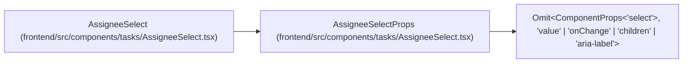

# AssigneeSelectProps

**Location:** `frontend/src/components/tasks/AssigneeSelect.tsx:5`
**Kind:** Interface
**Bases:** `Omit<ComponentProps<'select'>, 'value' | 'onChange' | 'children' | 'aria-label'>`
**Module:** [AssigneeSelect](../modules/AssigneeSelect.md)

## Description

_Auto-generated from `AssigneeSelectProps` in `frontend/src/components/tasks/AssigneeSelect.tsx`._

## Attributes

| Name | Type | Required | Default | Description |
|------|------|----------|---------|-------------|
| `'aria-label'` | `string` | Yes | — | — |
| `value` | `number \| null \| undefined` | Yes | — | — |
| `options` | `TaskRowAssigneeOption[]` | Yes | — | — |
| `emptyLabel` | `string` | Yes | — | — |
| `onChange` | `(assigneeId: number \| null) => void` | Yes | — | — |

## Methods

*No declared methods.*

## Relationships

<!-- Auto-generated relationship summary. Do not edit by hand. -->

### Summary

| Module | Methods | Attributes |
|---|---:|---|
| [AssigneeSelect](../modules/AssigneeSelect.md) | 0 | `'aria-label'`, `emptyLabel`, `onChange`, `options`, `value` |

### Structure

| Kind | Entity | Module |
|---|---|---|
| Base | `Omit<ComponentProps<'select'>, 'value' \| 'onChange' \| 'children' \| 'aria-label'>` | — |

### References

| Reference | Kind | Source | Call sites |
|---|---|---|---:|
| `AssigneeSelect` | type_reference | [AssigneeSelect](../modules/AssigneeSelect.md) | — |
