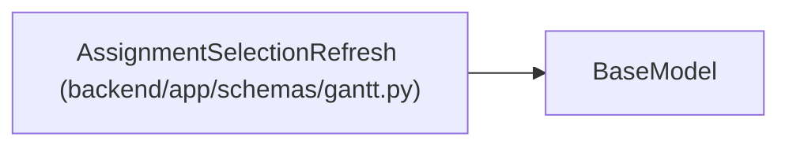

# AssignmentSelectionRefresh

**Location:** `backend/app/schemas/gantt.py:101`
**Kind:** Pydantic model
**Bases:** `BaseModel`
**Module:** [schemas_gantt](../modules/schemas_gantt.md)

## Description

_Auto-generated from `AssignmentSelectionRefresh` in `backend/app/schemas/gantt.py`._

The result identifies the task, queue assignment and actor whose model-bound selection refers to a prior task version. It carries the previous and new versions so the PM can obtain a fresh governed selection on the current work.

## Attributes

| Name | Type | Wire name | Required | Nullable | Default | Constraints | Examples | Description |
|------|------|-----------|----------|----------|---------|-------------|-------------|----------|
| `task_id` | `int` | `task_id` | Yes | No | — | — | — | — |
| `assignment_id` | `int` | `assignment_id` | Yes | No | — | — | — | — |
| `actor_id` | `int` | `actor_id` | Yes | No | — | — | — | — |
| `from_task_version` | `int` | `from_task_version` | Yes | No | — | — | — | — |
| `to_task_version` | `int` | `to_task_version` | Yes | No | — | — | — | — |
| `action` | `Literal['refresh_model_selection']` | `action` | Yes | No | — | — | — | — |

## Methods

*No declared methods.*

## Relationships

<!-- Auto-generated relationship summary. Do not edit by hand. -->

### Summary

| Module | Methods | Attributes |
|---|---:|---|
| [schemas_gantt](../modules/schemas_gantt.md) | 0 | `action`, `actor_id`, `assignment_id`, `from_task_version`, `task_id`, `to_task_version` |

### Structure

| Kind | Entity | Module |
|---|---|---|
| Base | `BaseModel` | — |
