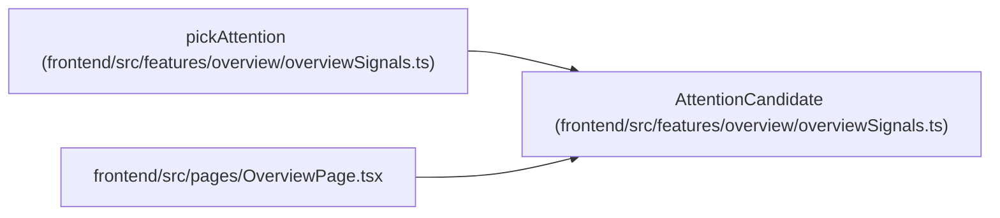

# AttentionCandidate

**Location:** `frontend/src/features/overview/overviewSignals.ts:227`
**Kind:** Interface
**Bases:** —
**Module:** [overviewSignals](../modules/overviewSignals.md)

## Description

_Auto-generated from `AttentionCandidate` in `frontend/src/features/overview/overviewSignals.ts`._

## Attributes

| Name | Type | Required | Default | Description |
|------|------|----------|---------|-------------|
| `kind` | `AttentionKind` | Yes | — | — |
| `count` | `number` | Yes | — | — |
| `iteration` | `Iteration \| null` | Yes | — | — |
| `plan` | `{ done: number; total: number; nextId: string }` | No | — | — |

## Methods

*No declared methods.*

## Relationships

<!-- Auto-generated relationship summary. Do not edit by hand. -->

### Summary

| Module | Methods | Attributes |
|---|---:|---|
| [overviewSignals](../modules/overviewSignals.md) | 0 | `count`, `iteration`, `kind`, `plan` |

### References

| Reference | Kind | Source | Call sites |
|---|---|---|---:|
| `pickAttention` | type_reference | [overviewSignals](../modules/overviewSignals.md) | — |
| `OverviewPage` | import | [OverviewPage](../modules/OverviewPage.md) | — |
