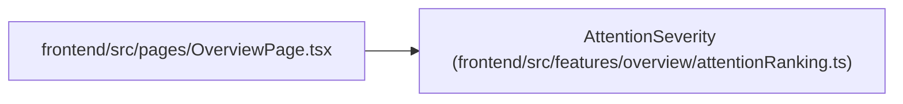

# AttentionSeverity

**Location:** `frontend/src/features/overview/attentionRanking.ts:3`
**Kind:** Type alias
**Bases:** —
**Module:** [attentionRanking](../modules/attentionRanking.md)
**Target:**

```typescript
'critical' | 'warning' | 'advisory'
```

## Description

_Auto-generated from `AttentionSeverity` in `frontend/src/features/overview/attentionRanking.ts`._

## Attributes

*See the alias definition for its member types.*

## Methods

*See the alias definition for callable and member types.*

## Relationships

<!-- Auto-generated relationship summary. Do not edit by hand. -->


### Summary

| Module | Methods | Attributes |
|---|---:|---|
| [attentionRanking](../modules/attentionRanking.md) | 0 | — |

### References

| Reference | Kind | Source | Call sites |
|---|---|---|---:|
| `OverviewPage` | import | [OverviewPage](../modules/OverviewPage.md) | — |
