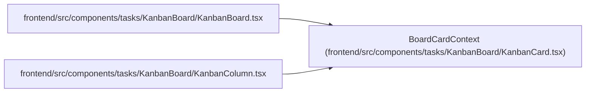

# BoardCardContext

**Location:** `frontend/src/components/tasks/KanbanBoard/KanbanCard.tsx:16`
**Kind:** Interface
**Bases:** —
**Module:** [KanbanCard](../modules/KanbanCard.md)

## Description

What a card needs beyond its task: the task map the state chip reads, shared by every card on the board.

## Attributes

| Name | Type | Required | Default | Description |
|------|------|----------|---------|-------------|
| `taskMap` | `Map<number, Task>` | Yes | — | — |

## Methods

*No declared methods.*

## Relationships

<!-- Auto-generated relationship summary. Do not edit by hand. -->

### Summary

| Module | Methods | Attributes |
|---|---:|---|
| [KanbanCard](../modules/KanbanCard.md) | 0 | `taskMap` |

### References

| Reference | Kind | Source | Call sites |
|---|---|---|---:|
| `KanbanBoard` | import | [KanbanBoard](../modules/KanbanBoard.md) | — |
| `KanbanColumn` | import | [KanbanColumn](../modules/KanbanColumn.md) | — |
