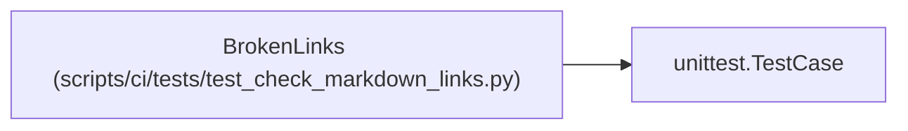

# BrokenLinks

**Location:** `scripts/ci/tests/test_check_markdown_links.py:11`
**Kind:** Class
**Bases:** `unittest.TestCase`
**Module:** [test_check_markdown_links](../modules/test_check_markdown_links.md)

## Description

_Auto-generated from `BrokenLinks` in `scripts/ci/tests/test_check_markdown_links.py`._

## Attributes

*No annotated attributes found.*

## Methods

| Method | Signature | Decorators | Description |
|--------|-----------|------------|-------------|
| `setUp` | `()` | — | — |
| `tearDown` | `()` | — | — |
| `_write` | `(relative: str, text: str) -> str` | — | — |
| `test_existing_relative_and_external_links_pass` | `()` | — | — |
| `test_missing_target_is_reported` | `()` | — | — |
| `test_wiki_pages_deleted_files_and_non_markdown_are_skipped` | `()` | — | — |

## Relationships

<!-- Auto-generated relationship summary. Do not edit by hand. -->

### Summary

| Module | Methods | Attributes |
|---|---:|---|
| [test_check_markdown_links](../modules/test_check_markdown_links.md) | 6 | — |

### Structure

| Kind | Entity | Module |
|---|---|---|
| Base | `unittest.TestCase` | — |
