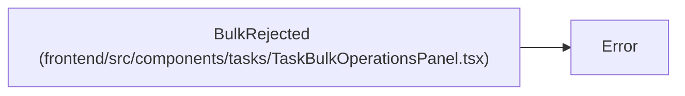

# BulkRejected

**Location:** `frontend/src/components/tasks/TaskBulkOperationsPanel.tsx:59`
**Kind:** Class
**Bases:** `Error`
**Module:** [TaskBulkOperationsPanel](../modules/TaskBulkOperationsPanel.md)

## Description

_Auto-generated from `BulkRejected` in `frontend/src/components/tasks/TaskBulkOperationsPanel.tsx`._

## Attributes

| Name | Type | Required | Default | Description |
|------|------|----------|---------|-------------|
| `failures` | `{ taskId: number; message: string }[]` | Yes | — | — |

## Methods

| Method | Signature | Decorators | Description |
|--------|-----------|------------|-------------|
| `constructor` | `(failures: { taskId: number; message: string }[])` | — | — |

## Relationships

<!-- Auto-generated relationship summary. Do not edit by hand. -->

### Summary

| Module | Methods | Attributes |
|---|---:|---|
| [TaskBulkOperationsPanel](../modules/TaskBulkOperationsPanel.md) | 1 | `failures` |

### Structure

| Kind | Entity | Module |
|---|---|---|
| Base | `Error` | — |
