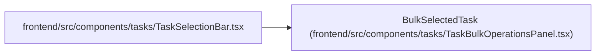

# BulkSelectedTask

**Location:** `frontend/src/components/tasks/TaskBulkOperationsPanel.tsx:22`
**Kind:** Type alias
**Bases:** —
**Module:** [TaskBulkOperationsPanel](../modules/TaskBulkOperationsPanel.md)
**Target:**

```typescript
Pick<Task, 'id' | 'title' | 'version'>
```

## Description

What the bar needs of a selected task.

## Attributes

*See the alias definition for its member types.*

## Methods

*See the alias definition for callable and member types.*

## Relationships

<!-- Auto-generated relationship summary. Do not edit by hand. -->


### Summary

| Module | Methods | Attributes |
|---|---:|---|
| [TaskBulkOperationsPanel](../modules/TaskBulkOperationsPanel.md) | 0 | — |

### References

| Reference | Kind | Source | Call sites |
|---|---|---|---:|
| `TaskSelectionBar` | import | [TaskSelectionBar](../modules/TaskSelectionBar.md) | — |
