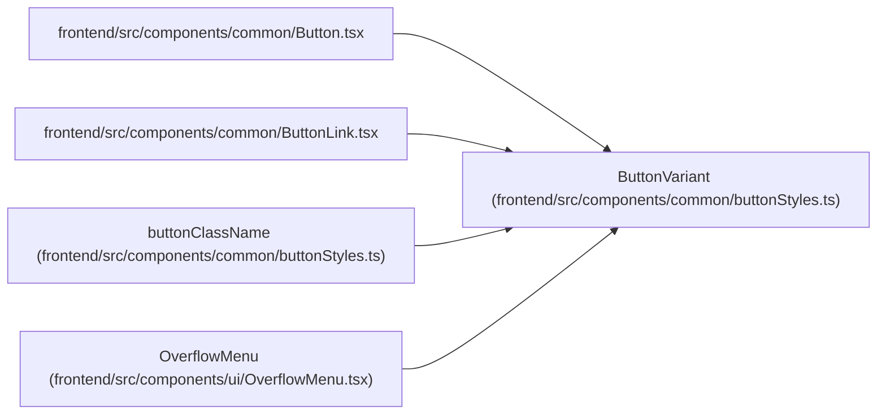

# ButtonVariant

**Location:** `frontend/src/components/common/buttonStyles.ts:3`
**Kind:** Type alias
**Bases:** —
**Module:** [buttonStyles](../modules/buttonStyles.md)
**Target:**

```typescript
'primary' | 'secondary' | 'danger' | 'warning' | 'ghost' | 'outline' | 'plain'
```

## Description

_Auto-generated from `ButtonVariant` in `frontend/src/components/common/buttonStyles.ts`._

## Attributes

*See the alias definition for its member types.*

## Methods

*See the alias definition for callable and member types.*

## Relationships

<!-- Auto-generated relationship summary. Do not edit by hand. -->


### Summary

| Module | Methods | Attributes |
|---|---:|---|
| [buttonStyles](../modules/buttonStyles.md) | 0 | — |

### References

| Reference | Kind | Source | Call sites |
|---|---|---|---:|
| `Button` | import | [Button](../modules/Button.md) | — |
| `ButtonLink` | import | [ButtonLink](../modules/ButtonLink.md) | — |
| `buttonClassName` | type_reference | [buttonStyles](../modules/buttonStyles.md) | — |
| `OverflowMenu` | type_reference | [OverflowMenu](../modules/OverflowMenu.md) | — |
