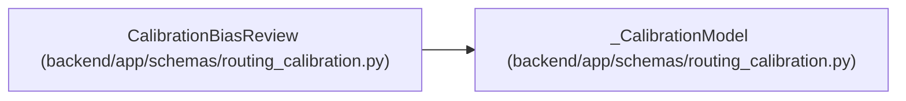

# CalibrationBiasReview

**Location:** `backend/app/schemas/routing_calibration.py:71`
**Kind:** Pydantic model
**Bases:** `_CalibrationModel`
**Module:** [schemas_routing_calibration](../modules/schemas_routing_calibration.md)

## Description

The record of the bias review the terms were checked against.

## Validators

| Method | Scope | Fields | Mode | Options |
|--------|-------|--------|------|---------|
| `strip_required` | field | reviewer, findings | after | — |
| `strip_optional` | field | mitigations | after | — |
| `require_timestamp_text` | field | reviewed_at | before | — |
| `require_timezone` | field | reviewed_at | after | — |

## Attributes

| Name | Type | Wire name | Required | Nullable | Default | Constraints | Examples | Description |
|------|------|-----------|----------|----------|---------|-------------|-------------|----------|
| `reviewer` | `str` | `reviewer` | Yes | No | — | min_length=1; max_length=unknown (MAX_CALIBRATION_LABEL) | — | — |
| `reviewed_at` | `datetime` | `reviewed_at` | Yes | No | — | — | — | — |
| `findings` | `str` | `findings` | Yes | No | — | min_length=1; max_length=unknown (MAX_CALIBRATION_TEXT) | — | — |
| `mitigations` | `str \| None` | `mitigations` | No | Yes | `None` | max_length=unknown (MAX_CALIBRATION_TEXT) | — | — |

## Methods

| Method | Signature | Decorators | Description |
|--------|-----------|------------|-------------|
| `strip_required` | `(value: str, info: Any) -> str` | `@field_validator('reviewer', 'findings')`, `@classmethod` | — |
| `strip_optional` | `(value: str \| None) -> str \| None` | `@field_validator('mitigations')`, `@classmethod` | — |
| `require_timestamp_text` | `(value: object) -> object` | `@field_validator('reviewed_at', mode='before')`, `@classmethod` | — |
| `require_timezone` | `(value: datetime) -> datetime` | `@field_validator('reviewed_at')`, `@classmethod` | — |

## Relationships

<!-- Auto-generated relationship summary. Do not edit by hand. -->

### Summary

| Module | Methods | Attributes |
|---|---:|---|
| [schemas_routing_calibration](../modules/schemas_routing_calibration.md) | 4 | `findings`, `mitigations`, `reviewed_at`, `reviewer` |

### Structure

| Kind | Entity | Module |
|---|---|---|
| Base | `_CalibrationModel` | [schemas_routing_calibration](../modules/schemas_routing_calibration.md) |
