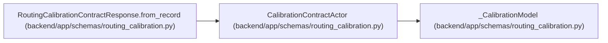

# CalibrationContractActor

**Location:** `backend/app/schemas/routing_calibration.py:194`
**Kind:** Pydantic model
**Bases:** `_CalibrationModel`
**Module:** [schemas_routing_calibration](../modules/schemas_routing_calibration.md)

## Description

Who issued a command: the operator's admin key, or an agent actor.

## Attributes

| Name | Type | Wire name | Required | Nullable | Default | Constraints | Examples | Description |
|------|------|-----------|----------|----------|---------|-------------|-------------|----------|
| `actor_type` | `str` | `actor_type` | Yes | No | — | — | — | — |
| `actor_id` | `int \| None` | `actor_id` | No | Yes | `None` | — | — | — |

## Methods

*No declared methods.*

## Relationships

<!-- Auto-generated relationship summary. Do not edit by hand. -->

### Summary

| Module | Methods | Attributes |
|---|---:|---|
| [schemas_routing_calibration](../modules/schemas_routing_calibration.md) | 0 | `actor_id`, `actor_type` |

### Structure

| Kind | Entity | Module |
|---|---|---|
| Base | `_CalibrationModel` | [schemas_routing_calibration](../modules/schemas_routing_calibration.md) |

### References

| Reference | Kind | Source | Call sites |
|---|---|---|---:|
| `RoutingCalibrationContractResponse.from_record` | call | [schemas_routing_calibration](../modules/schemas_routing_calibration.md) | 2 |
