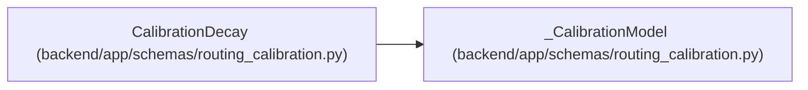

# CalibrationDecay

**Location:** `backend/app/schemas/routing_calibration.py:60`
**Kind:** Pydantic model
**Bases:** `_CalibrationModel`
**Module:** [schemas_routing_calibration](../modules/schemas_routing_calibration.md)

## Description

How an older observation's weight falls.

``days`` is the half-life for ``exponential``, the age at which weight
reaches zero for ``linear``, and the length of the window for ``window``.

## Attributes

| Name | Type | Wire name | Required | Nullable | Default | Constraints | Examples | Description |
|------|------|-----------|----------|----------|---------|-------------|-------------|----------|
| `method` | `CalibrationDecayMethod` | `method` | Yes | No | — | — | — | — |
| `days` | `int` | `days` | Yes | No | — | ge=1; strict=True; le=unknown (MAX_CALIBRATION_DAYS) | — | — |

## Methods

*No declared methods.*

## Relationships

<!-- Auto-generated relationship summary. Do not edit by hand. -->

### Summary

| Module | Methods | Attributes |
|---|---:|---|
| [schemas_routing_calibration](../modules/schemas_routing_calibration.md) | 0 | `days`, `method` |

### Structure

| Kind | Entity | Module |
|---|---|---|
| Base | `_CalibrationModel` | [schemas_routing_calibration](../modules/schemas_routing_calibration.md) |
