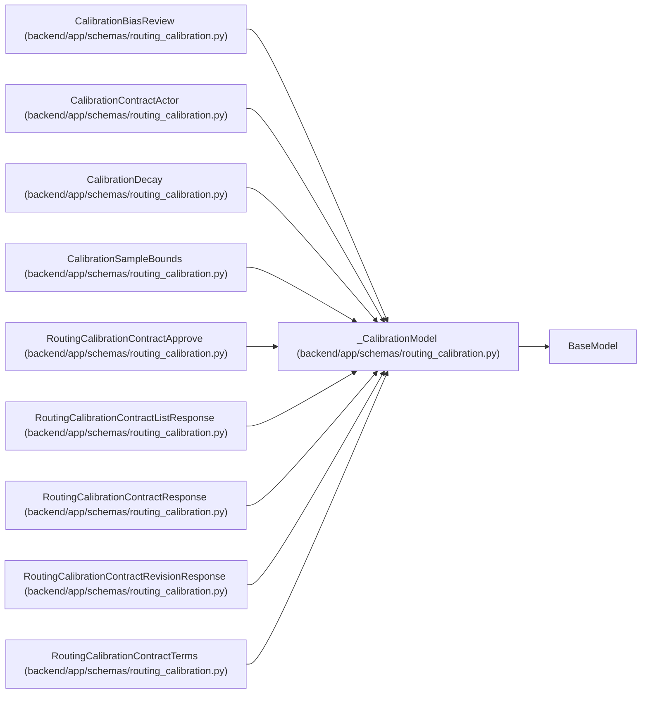

# _CalibrationModel

**Location:** `backend/app/schemas/routing_calibration.py:31`
**Kind:** Pydantic model
**Bases:** `BaseModel`
**Module:** [schemas_routing_calibration](../modules/schemas_routing_calibration.md)

## Description

_Auto-generated from `_CalibrationModel` in `backend/app/schemas/routing_calibration.py`._

## Model Configuration

| Setting | Value | Source |
|---------|-------|--------|
| `extra` | `'forbid'` | model_config |
| `from_attributes` | `True` | model_config |

## Attributes

*No annotated attributes found.*

## Methods

*No declared methods.*

## Relationships

<!-- Auto-generated relationship summary. Do not edit by hand. -->

### Summary

| Module | Methods | Attributes |
|---|---:|---|
| [schemas_routing_calibration](../modules/schemas_routing_calibration.md) | 0 | — |

### Structure

| Kind | Entity | Module |
|---|---|---|
| Base | `BaseModel` | — |
| Subclass | `CalibrationBiasReview` | [schemas_routing_calibration](../modules/schemas_routing_calibration.md) |
| Subclass | `CalibrationContractActor` | [schemas_routing_calibration](../modules/schemas_routing_calibration.md) |
| Subclass | `CalibrationDecay` | [schemas_routing_calibration](../modules/schemas_routing_calibration.md) |
| Subclass | `CalibrationSampleBounds` | [schemas_routing_calibration](../modules/schemas_routing_calibration.md) |
| Subclass | `RoutingCalibrationContractApprove` | [schemas_routing_calibration](../modules/schemas_routing_calibration.md) |
| Subclass | `RoutingCalibrationContractListResponse` | [schemas_routing_calibration](../modules/schemas_routing_calibration.md) |
| Subclass | `RoutingCalibrationContractResponse` | [schemas_routing_calibration](../modules/schemas_routing_calibration.md) |
| Subclass | `RoutingCalibrationContractRevisionResponse` | [schemas_routing_calibration](../modules/schemas_routing_calibration.md) |
| Subclass | `RoutingCalibrationContractTerms` | [schemas_routing_calibration](../modules/schemas_routing_calibration.md) |
