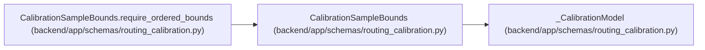

# CalibrationSampleBounds

**Location:** `backend/app/schemas/routing_calibration.py:46`
**Kind:** Pydantic model
**Bases:** `_CalibrationModel`
**Module:** [schemas_routing_calibration](../modules/schemas_routing_calibration.md)

## Description

How many observations, and how old, a calibration may use per model and key.

## Validators

| Method | Scope | Fields | Mode | Options |
|--------|-------|--------|------|---------|
| `require_ordered_bounds` | model | — | after | — |

## Attributes

| Name | Type | Wire name | Required | Nullable | Default | Constraints | Examples | Description |
|------|------|-----------|----------|----------|---------|-------------|-------------|----------|
| `minimum_samples` | `int` | `minimum_samples` | Yes | No | — | ge=1; strict=True; le=unknown (MAX_CALIBRATION_SAMPLES) | — | — |
| `maximum_samples` | `int` | `maximum_samples` | Yes | No | — | ge=1; strict=True; le=unknown (MAX_CALIBRATION_SAMPLES) | — | — |
| `maximum_age_days` | `int` | `maximum_age_days` | Yes | No | — | ge=1; strict=True; le=unknown (MAX_CALIBRATION_DAYS) | — | — |

## Methods

| Method | Signature | Decorators | Description |
|--------|-----------|------------|-------------|
| `require_ordered_bounds` | `() -> 'CalibrationSampleBounds'` | `@model_validator(mode='after')` | — |

## Relationships

<!-- Auto-generated relationship summary. Do not edit by hand. -->

### Summary

| Module | Methods | Attributes |
|---|---:|---|
| [schemas_routing_calibration](../modules/schemas_routing_calibration.md) | 1 | `maximum_age_days`, `maximum_samples`, `minimum_samples` |

### Structure

| Kind | Entity | Module |
|---|---|---|
| Base | `_CalibrationModel` | [schemas_routing_calibration](../modules/schemas_routing_calibration.md) |

### References

| Reference | Kind | Source | Call sites |
|---|---|---|---:|
| `CalibrationSampleBounds.require_ordered_bounds` | type_reference | [schemas_routing_calibration](../modules/schemas_routing_calibration.md) | — |
