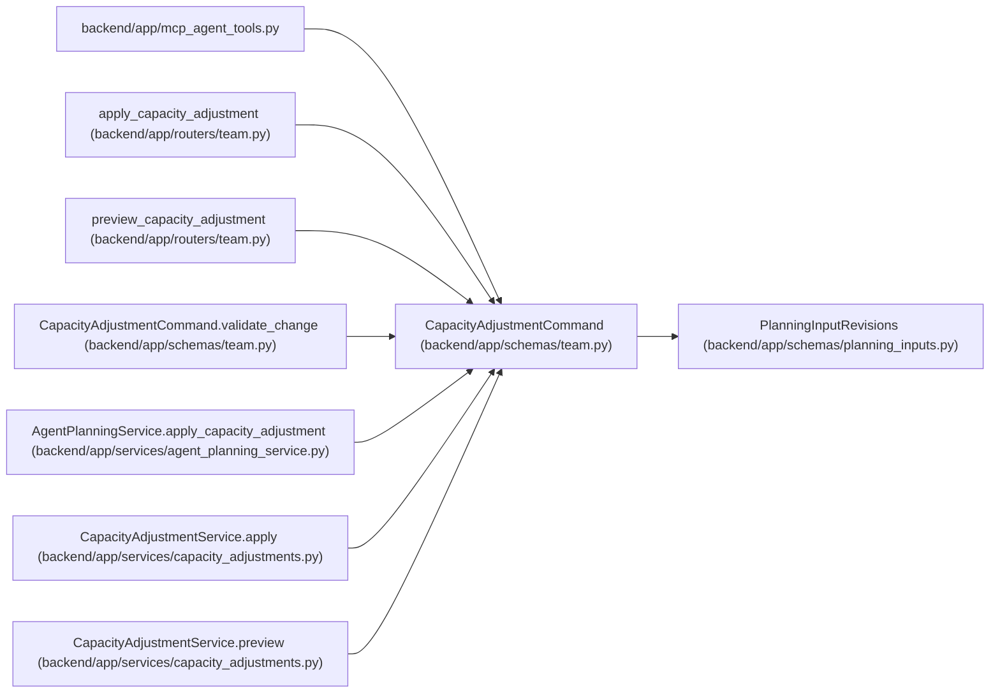

# CapacityAdjustmentCommand

**Location:** `backend/app/schemas/team.py:422`
**Kind:** Class
**Bases:** `PlanningInputRevisions`
**Module:** [schemas_team](../modules/schemas_team.md)

## Description

Record and withdraw dated adjustments on one capacity row in one command.

## Validators

| Method | Scope | Fields | Mode | Options |
|--------|-------|--------|------|---------|
| `validate_change` | model | — | after | — |

## Attributes

| Name | Type | Wire name | Required | Nullable | Default | Constraints | Examples | Description |
|------|------|-----------|----------|----------|---------|-------------|-------------|----------|
| `adjustments` | `list[CapacityAdjustmentItem]` | `adjustments` | No | No | factory: `list` | max_length=50 | — | — |
| `withdraw_adjustment_ids` | `list[int]` | `withdraw_adjustment_ids` | No | No | factory: `list` | max_length=50 | — | — |
| `reason` | `str` | `reason` | Yes | No | — | max_length=1000; min_length=1 | — | — |

## Methods

| Method | Signature | Decorators | Description |
|--------|-----------|------------|-------------|
| `validate_change` | `() -> 'CapacityAdjustmentCommand'` | `@model_validator(mode='after')` | — |

## Relationships

<!-- Auto-generated relationship summary. Do not edit by hand. -->

### Summary

| Module | Methods | Attributes |
|---|---:|---|
| [schemas_team](../modules/schemas_team.md) | 1 | `adjustments`, `reason`, `withdraw_adjustment_ids` |

### Structure

| Kind | Entity | Module |
|---|---|---|
| Base | `PlanningInputRevisions` | [planning_inputs](../modules/planning_inputs.md) |

### References

| Reference | Kind | Source | Call sites |
|---|---|---|---:|
| `mcp_agent_tools` | import | [mcp_agent_tools](../modules/mcp_agent_tools.md) | — |
| `apply_capacity_adjustment` | type_reference | [routers_team](../modules/routers_team.md) | — |
| `preview_capacity_adjustment` | type_reference | [routers_team](../modules/routers_team.md) | — |
| `CapacityAdjustmentCommand.validate_change` | type_reference | [schemas_team](../modules/schemas_team.md) | — |
| `AgentPlanningService.apply_capacity_adjustment` | type_reference | [agent_planning_service](../modules/agent_planning_service.md) | — |
| `CapacityAdjustmentService.apply` | type_reference | [capacity_adjustments](../modules/capacity_adjustments.md) | — |
| `CapacityAdjustmentService.preview` | type_reference | [capacity_adjustments](../modules/capacity_adjustments.md) | — |
