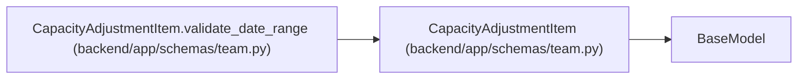

# CapacityAdjustmentItem

**Location:** `backend/app/schemas/team.py:404`
**Kind:** Pydantic model
**Bases:** `BaseModel`
**Module:** [schemas_team](../modules/schemas_team.md)

## Description

One dated replacement of a capacity row's availability percentage.

## Validators

| Method | Scope | Fields | Mode | Options |
|--------|-------|--------|------|---------|
| `validate_date_range` | model | — | after | — |

## Attributes

| Name | Type | Wire name | Required | Nullable | Default | Constraints | Examples | Description |
|------|------|-----------|----------|----------|---------|-------------|-------------|----------|
| `start_date` | `date` | `start_date` | Yes | No | — | — | — | — |
| `end_date` | `date` | `end_date` | Yes | No | — | — | — | — |
| `availability_percent` | `float` | `availability_percent` | Yes | No | — | ge=0; le=100 | — | — |
| `reason` | `Optional[str]` | `reason` | No | Yes | `None` | max_length=1000 | — | — |

## Methods

| Method | Signature | Decorators | Description |
|--------|-----------|------------|-------------|
| `validate_date_range` | `() -> 'CapacityAdjustmentItem'` | `@model_validator(mode='after')` | — |

## Relationships

<!-- Auto-generated relationship summary. Do not edit by hand. -->

### Summary

| Module | Methods | Attributes |
|---|---:|---|
| [schemas_team](../modules/schemas_team.md) | 1 | `availability_percent`, `end_date`, `reason`, `start_date` |

### Structure

| Kind | Entity | Module |
|---|---|---|
| Base | `BaseModel` | — |

### References

| Reference | Kind | Source | Call sites |
|---|---|---|---:|
| `CapacityAdjustmentItem.validate_date_range` | type_reference | [schemas_team](../modules/schemas_team.md) | — |
